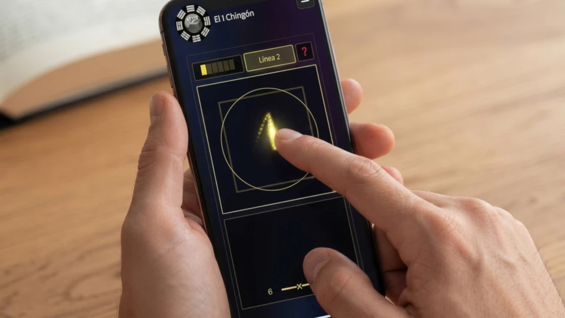


Wenn Leute an das I Ging denken, stellen sie sich meist drei chinesische Münzen mit einem quadratischen Loch in der Mitte vor. Neben praktischen Gründen spiegelte dieses quadratische Loch in der Mitte einer runden Münze den alten chinesischen Glauben wider, dass „der Himmel rund und die Erde quadratisch ist“ (天圆地方). 

Himmel und Erde, Yin und Yang, sind die beiden komplementären Gegensätze, aus denen alles andere im System fließt. Wenn du also das I Ging konsultierst, steht eine Seite jeder der drei Münzen (normalerweise Kopf) für Yang, während die andere Seite (Zahl) für Yin steht. Auf dieser Website habe ich einen ausführlichen Artikel darüber geschrieben, [wie man das I Ging mit drei Münzen konsultiert](). Dort wird im Detail erklärt, wie du die 6 Linien für deinen I Ging-Wurf erhältst.

## Die Ursprüngliche Methode: Schafgarbenstängel

Es gibt noch eine weitere Methode, um das I Ging zu werfen: die Schafgarbenstängel-Methode. Dies war die ursprünglich im alten China verwendete Methode, bei der 50 Stängel der Schafgarbenpflanze verwendet werden. Diese wuchs häufig an heiligen Stätten, und man glaubte, dass sie die Energien dieser Orte in sich trug. Diese Methode der I Ging-Konsultation war jedoch erheblich mühsamer, weshalb die Münzmethode beliebter wurde.

Abgesehen von dem größeren Aufwand gibt es noch einen weiteren Unterschied zwischen dieser und der Münzmethode: die Wahrscheinlichkeiten, die Werte 6, 7, 8 oder 9 zu erhalten.

| Linienwert | Wahrscheinlichkeit |
| :--- | :--- |
| 6 ━━━x━━━ | \(\frac{1}{16}\) |
| 7 ━━━━━━━ | \(\frac{5}{16}\) |
| 8 ━━╸ ╺━━ | \(\frac{7}{16}\) |
| 9 ━━━o━━━ | \(\frac{3}{16}\) |

## Eine Digitale Alternative: Kinetische Entropie

Heutzutage, im Zeitalter des digitalen Geldes, ist es manchmal schwer, überhaupt noch Münzen zu finden. Deshalb habe ich für meine I Ging-Konsultations-App einen Mechanismus entwickelt, der es dir ermöglicht, aus deinen eigenen physischen Bewegungen Zufälligkeit zu generieren – genau wie beim physischen Werfen von Münzen oder beim Manipulieren von Schafgarbenstängeln. Ich habe diesen Mechanismus "Kinästhetische Entropie-Erfassung" (Kinesthetic Entropy Capture, KEG) genannt. Ich erkläre die Funktionsweise von KEG genauer in meinem [Whitepaper]().

Auf dem anfänglichen Konsultationsbildschirm gibst du einfach deinen Namen (oder dein Pseudonym) sowie den Titel deiner Konsultation ein und drückst auf die orangefarbene Schaltfläche „Konsultation beginnen“.

Beachte, wie der App-Bildschirm ein Quadrat und einen Kreis aufweist, die die alten Münzen widerspiegeln. Du bewegst deinen Finger oder den Mauszeiger mit gedrückter Maustaste über diesen Bereich („Himmel ist rund, Erde ist quadratisch“) und hinterlässt dabei eine Spur von Punkten. Diese Punktespur erzeugt die für den Prozess erforderliche echte Zufälligkeit.

## Wie Du Dein Hexagramm Erstellst

Wenn genügend Zufälligkeit erzeugt wurde, wird die Schaltfläche für die erste Linie (Linie 1) aktiviert. Wenn du sie drückst, generierst du die erste oder unterste Linie. Diesen Vorgang wiederholst du bis zur sechsten Linie.

Sobald die sechste Linie generiert ist, drückst du die Schaltfläche Weiter. Die App zeigt dir dann die resultierende Hexagrammnummer, die zukünftige Hexagrammnummer sowie die wandelnden Linien an (falls vorhanden). Auf diesem Bildschirm kannst du entweder den kostenlosen PDF-Bericht oder eine KI-Interpretation deines Wurfs anfordern. Beachte, dass du für den Zugriff auf die KI-Interpretation einen Prepaid-Gutscheincode eingeben musst. Jeden Tag gibt meine Seite 10 kostenlose Gutscheincodes heraus – einen pro Benutzer/Computer. Wenn noch welche verfügbar sind, kannst du deinen kostenlosen Gutscheincode anfordern, indem du auf die entsprechende Schaltfläche klickst. Wenn du deine KI-Interpretation anforderst, ist es sehr wichtig, dass du den vollständigen Kontext in das Textfeld eingibst. Dies ist deine ursprüngliche Frage mit allen Hintergründen, die die KI benötigt, um deine Orakellesung richtig zu interpretieren.

## Vergangene Oder Physische Würfe Eingeben

Für diejenigen unter euch, die weiterhin ihre eigenen Münzen (oder Schafgarbenstängel) verwenden möchten oder einfach einen an einem früheren Datum durchgeführten Wurf für eine KI-Interpretation reproduzieren wollen, bietet die App die Möglichkeit, die 6 Linienwerte manuell einzugeben. Um auf diese Funktion zuzugreifen, musst du auf das Dropdown-Menü „⚙️ Erweiterte Optionen (Optional)“ klicken und dort die Option „Manuell“ (neben „Interaktive Simulation“) auswählen. Das Textfeld „Konsultationsdatum“ wird dann aktiviert, damit du das Datum der Konsultation im Format JJJJ-MM-TT (z. B. 2026-11-03) eingeben kannst. Du musst hier unbedingt das Datum eintragen, an dem du die Konsultation physisch durchgeführt hast. Dies ist besonders wichtig für die Liu Yao-Wahrsagemethoden, die auf das exakte Datum der I Ging-Konsultation angewiesen sind.



Wie beim interaktiven Simulationsmodus drückst du nun unten auf die orangefarbene Schaltfläche „Konsultation beginnen“ und gelangst zu einem Bildschirm, auf dem du die verschiedenen Werte (6, 7, 8 oder 9) für jede der sechs Linien des Hexagramms auswählen kannst. Drücke noch einmal Weiter, wenn du fertig bist, um zur Auswertung zu gelangen.

## Die Verbindung Von Alter Tradition Und Modernen Systemen

Egal, ob du dich dafür entscheidest, die Ergebnisse eines physischen Münzwurfs einzugeben, oder die Kinästhetische Entropie-Erfassung der App nutzt, um direkt auf deinem Bildschirm zu werfen – das Ziel bleibt dasselbe: der reibungslose Zugriff auf die strukturelle Logik des I Ging. Indem die physischen Einschränkungen traditioneller Methoden durch ein interaktives digitales System ersetzt werden, wird der Konsultationsprozess unmittelbar und überall zugänglich.

Besuche die [Konsultations-App]() auf unserer Website, um diese kinetische Wurf-Methode selbst zu erleben, und erforsche die Dynamik deiner I Ging-Lesung durch unsere KI-gestützte hermeneutische Analyse.