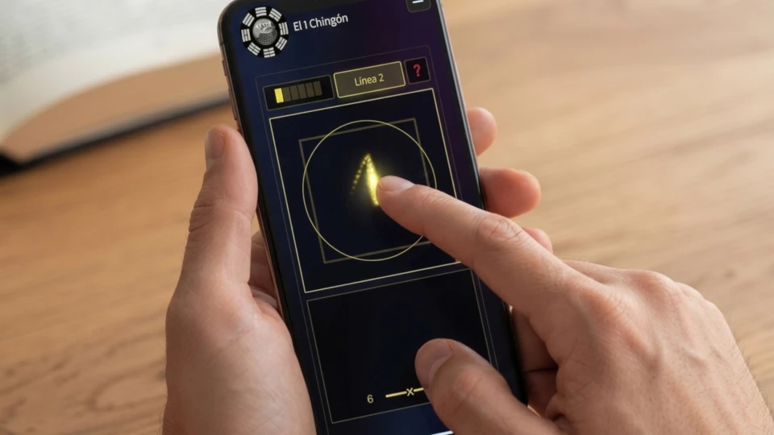


When people think about the I Ching, they usually think of three chinese coins with a square hole in the middle. Besides practical reasons, this square hole in the middle of a round coin reflected the ancient chinese belief that "Heaven is round, Earth is square" or 天圆地方. 

Heaven and Earth, Yin and Yang, are the two complementary opposites from which everything else in the system flows, so that when you are consulting the I Ching, one side of each of the three coins, usually heads, will be Yang, while the other, tails, will be Yin. In this website, I have a whole article on [how to consult the I Ching with three coins](). It breaks down in detail how to obtain the 6 lines for your I Ching casting.

## The Original Method: Yarrow Stalks

There's another method for casting the I Ching - the yarrow stalk method. It was the method originally used in ancient China, and involves using 50 stalks of yarrow plant, which commonly grew around sacred sites and was believed to contain the energies of those places. This method of consulting the I Ching, however, was considerably more laborious and the coin method became more popular.

Besides being more laborious to obtain an I Ching casting through this method, there is another difference between it and the coin method: the probabilities of obtaining the 6, 7, 8 or 9 values.

| Line value | Probability |
| :--- | :--- |
| 6 ━━━x━━━ | \(\frac{1}{16}\) |
| 7 ━━━━━━━ | \(\frac{5}{16}\) |
| 8 ━━╸ ╺━━ | \(\frac{7}{16}\) |
| 9 ━━━o━━━ | \(\frac{3}{16}\) |

## A Digital Alternative: Kinetic Entropy

Nowadays, in the era of digital money, it is hard to even find coins so for my I ching consultation app, I have built a mechanism that enables you to generate randomness from your own physical movements, just as you would if you were to physically toss three coins or manipulate the yarrow stalks. I have called this mechanism Kinesthetic Entropy Capture (KEG), and just like physically manipulating coins or yarrow stalks, it generates randomness from your own physical movements. I explain KEG in my [whitepaper]().

From the initial consultation screen, just press the orange "Begin Consultation" button below after entering your name or pseudonym, and your consultation title.

Notice how the app screen features a square and a circle, mirroring the ancient coins. You move your finger, or the mouse cursor with the mouse button pressed, over this "Heaven is Round, Earth is Square" area, leaving a trail of points. This trail of points is what generates the randomness needed for the process.

## How to Cast Your Hexagram

When enough randomness is generated, the button for the first line (Line 1) is enabled. If you press it, you generate the first or bottom line. Then you repeat the process all the way up to the sixth line.

Once the sixth line is generated, you press the Continue button. The app will indicate the resulting hexagram number and the future hexagram number as well as the moving lines, if there are any. From that screen, you can either request the free pdf report or an AI interpretation of your casting. Note that to access your AI interpretation, you have to enter a pre-paid voucher code. Every day, my site issues 10 free voucher codes- one per user/computer. If there are any available, you may request your free voucher code by pressing the button. When requesting your AI interpretation, it is very important that you indicate the full context in the respective text box. This is your original question with the full context, which the AI requires to interpret your oracle reading correctly.

## Entering Past or Physical Castings

For those of you who still want to use their own coins (or yarrow stalks), or simply wish to reproduce a casting made on a previous date for AI interpretation, the app allows you to enter the 6 line values manually. To access that feature, you must press the "⚙️ Advanced Options (Optional)" drop down menu, and from there, mark the "Manual" option next to the "Interactive Simulation" option. The "Consultation Date" text box is enabled to allow you to enter the date of consultation in the YYYY-MM-DD format (for example 2026-11-03). You should enter the date when you made the consultation. This is important especially for the Liu Yao divination methods, which rely on the correct date when the I Ching was consulted.



As with the Interactive Simulation mode to cast your hexagrams, you press the orange "Begin Consultation" button below and you will be taken to a screen where you can select the different values (6,7,8 or 9) for each of the hexagram's six lines. Once again, press Continue when you're done to proceed to the next screen.

## Bridging Ancient Tradition and Modern Systems

Whether you choose to input the results of a physical coin toss or use the app's Kinesthetic Entropy Capture to cast directly on your screen, the goal remains the same: accessing the structural logic of the I Ching without unnecessary friction. By replacing the physical limitations of traditional methods with an interactive digital system, the consultation process becomes immediate and accessible anywhere.

Visit the [consultation app]() on our website to experience this kinetic casting method for yourself, and explore the dynamics of your I Ching reading through our AI-assisted hermeneutic analysis.