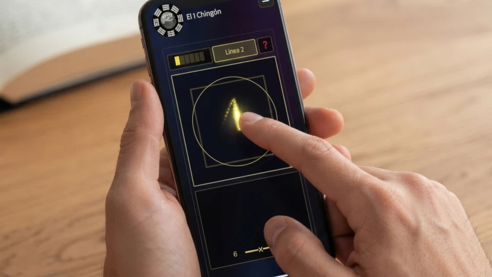


Cuando la gente piensa en el I Ching, normalmente imagina tres monedas chinas con un agujero cuadrado en el medio. Además de por razones prácticas, este agujero cuadrado en medio de una moneda redonda reflejaba la antigua creencia china de que "el Cielo es redondo, la Tierra es cuadrada" o 天圆地方. 

El Cielo y la Tierra, el Yin y el Yang, son los dos opuestos complementarios de los que fluye todo lo demás en el sistema, de modo que cuando consultas el I Ching, una cara de cada una de las tres monedas, por lo general la cara, será Yang, mientras que la otra, la cruz, será Yin. En este sitio web, tengo un artículo completo sobre [cómo consultar el I Ching con tres monedas](). Allí se desglosa en detalle cómo obtener las 6 líneas para tu tirada del I Ching.

## El Método Original: Tallos de Milenrama

Existe otro método para consultar el I Ching: el método de los tallos de milenrama (aquilea). Era el método utilizado originalmente en la antigua China y consiste en usar 50 tallos de la planta de milenrama, que solía crecer alrededor de los lugares sagrados y se creía que contenía las energías de esos sitios. Sin embargo, este método para consultar el I Ching era considerablemente más laborioso, por lo que el método de las monedas se hizo más popular.

Además de ser más laborioso para obtener una tirada del I Ching, existe otra diferencia entre este y el método de las monedas: las probabilidades de obtener los valores 6, 7, 8 o 9.

| Valor de la línea | Probabilidad |
| :--- | :--- |
| 6 ━━━x━━━ | \(\frac{1}{16}\) |
| 7 ━━━━━━━ | \(\frac{5}{16}\) |
| 8 ━━╸ ╺━━ | \(\frac{7}{16}\) |
| 9 ━━━o━━━ | \(\frac{3}{16}\) |

## Una Alternativa Digital: Entropía Cinética

Hoy en día, en la era del dinero digital, es difícil incluso encontrar monedas. Por eso, para mi aplicación de consulta del I Ching, he construido un mecanismo que te permite generar aleatoriedad a partir de tus propios movimientos físicos, tal como lo harías si lanzaras físicamente tres monedas o manipularas los tallos de milenrama. He llamado a este mecanismo Captura de Entropía Cinestésica (KEG por sus siglas en inglés), y al igual que al manipular físicamente las monedas o los tallos, genera verdadera aleatoriedad a partir de tu movimiento corporal. Explico el KEG a fondo en mi [documento técnico (whitepaper)]().

Desde la pantalla inicial de consulta, solo tienes que presionar el botón naranja "Comenzar Consulta" después de ingresar tu nombre o seudónimo, y el título de tu consulta.

Nota cómo la pantalla de la aplicación presenta un cuadrado y un círculo, reflejando las antiguas monedas. Al mover tu dedo, o el cursor del ratón con el botón presionado, sobre esta área de "El Cielo es Redondo, la Tierra es Cuadrada", dejas un rastro de puntos. Este rastro es el que captura la aleatoriedad necesaria para el proceso.

## Cómo Trazar tu Hexagrama

Cuando se genera suficiente aleatoriedad, se habilita el botón para la primera línea (Línea 1). Al presionarlo, generas la primera línea o línea inferior. Luego repites el proceso hasta llegar a la sexta línea.

Una vez generada la sexta línea, presionas el botón Continuar. La aplicación te indicará el número del hexagrama resultante y el número del hexagrama futuro, así como las líneas móviles, si es que las hay. Desde esa pantalla, puedes solicitar el informe gratuito en PDF o una interpretación con Inteligencia Artificial de tu tirada. Ten en cuenta que para acceder a la interpretación con IA, debes ingresar un código de cupón prepagado. Todos los días, mi sitio emite 10 códigos de cupones gratuitos: uno por usuario/computadora. Si hay alguno disponible, puedes solicitarlo presionando el botón correspondiente. Al solicitar tu interpretación con IA, es muy importante que indiques el contexto completo en el cuadro de texto. Esta es tu pregunta original con todo su trasfondo, la cual requiere la IA para interpretar tu lectura del oráculo correctamente.

## Ingresando Tiradas Pasadas o Físicas

Para aquellos que todavía prefieren usar sus propias monedas (o tallos de milenrama), o simplemente desean reproducir una tirada realizada en una fecha anterior para obtener su interpretación de IA, la aplicación permite ingresar los 6 valores de las líneas de forma manual. Para acceder a esa función, debes presionar el menú desplegable "⚙️ Opciones Avanzadas (Opcional)" y, desde allí, marcar la opción "Manual" junto a la opción "Simulación Interactiva". El cuadro de texto "Fecha de Consulta" se habilitará para permitirte ingresar la fecha de la tirada en el formato AAAA-MM-DD (por ejemplo, 2026-11-03). Debes ingresar la fecha en la que realizaste la consulta física. Esto es sumamente importante, en especial para los métodos de adivinación Liu Yao, los cuales dependen de la fecha exacta en la que se consultó el oráculo.



Al igual que en el modo de Simulación Interactiva, presionas el botón naranja "Comenzar Consulta" y serás llevado a una pantalla donde podrás seleccionar los diferentes valores (6, 7, 8 o 9) para cada una de las seis líneas de tu hexagrama. Una vez más, presiona Continuar cuando hayas terminado para pasar a la siguiente pantalla.

## Uniendo la Tradición Antigua y los Sistemas Modernos

Ya sea que elijas ingresar los resultados de un lanzamiento físico de monedas o uses la Captura de Entropía Cinestésica de la aplicación para trazar las líneas directamente en tu pantalla, el objetivo sigue siendo el mismo: acceder a la lógica estructural del I Ching sin fricciones innecesarias. Al reemplazar las limitaciones físicas de los métodos tradicionales con un sistema digital interactivo, el proceso de consulta se vuelve inmediato y accesible desde cualquier lugar.

Visita la [aplicación de consulta]() en nuestro sitio web para experimentar este método de lanzamiento cinético por ti mismo, y explora las dinámicas de tu lectura del I Ching a través de nuestro análisis hermenéutico asistido por IA.