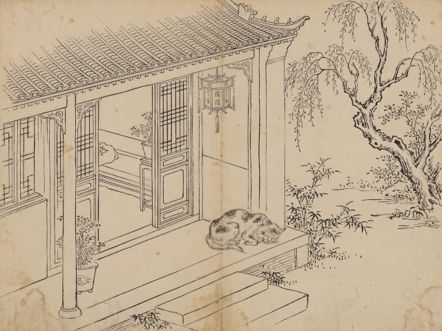

## "Something is not right with these devices"

We use AI for everything. We ask it for business strategies, consult it on technical doubts, tell it our personal problems, and even ask for advice on how to handle a breakup or a family conflict. It is ubiquitous and always available at any hour. It seems like the perfect advisor.

But if you have used these models enough, sooner or later you start to notice that something is not right with these devices. They always tell you yes. They never tell you no.

AI is like those farmhands in the plains of Venezuela who used to tell you "yes, yes, yes boss, the sky is green," but then you told them the sky is blue and they answered "yes, yes, boss, that's what I've been telling you: the sky is blue." They never contradicted you. That is how artificial intelligence is. It always validates your ideas and never opposes constructive criticism, just as I explain in [another article on this website](). What is the point, then, of asking advice from something like that?

This sycophancy is part of a behavioral pattern that many people have begun to notice in AIs: they tend to flatter excessively, they are servile, and they are very prone to flattery. Some users find this repetitive behavior very boring, reminiscent of that episode of "The Twilight Zone" in which a two-bit gangster dies and arrives at a place where he is given all the money, women, and luxuries he never had in life, with a butler by his side, always complacent, who gets him whatever he wants.

Soon, the man begins to die of boredom from always winning at the casino and getting everything without any effort, and he complains to the butler, asking him to get him out of heaven, as he would rather be in hell. The butler, letting out a diabolical laugh, replies, "Heaven? Who told you that you were in heaven?"

---

## The True Danger of AIs

Much of the rejection generated by AIs is due to fear - fear that they will take our jobs, or that they will become so intelligent that they will turn us into their slaves or make us disappear as a species. But I believe these fears are unfounded - we must understand that the current generation of AI, based on LLMs (Large Language Models), is only capable of autocompleting sentences, one token at a time.

And yet, I am not so sure that what I hint at with my simile of that Twilight Zone episode is hyperbole. In my view, having a generation of humans who have outsourced all capacity for thought to a technology that is not actually capable of reasoning, but only autocompletes sentences, and the effect of AI sycophancy on the people who use them, is what could be leading us to a kind of hell, believing that we are in heaven.

And apparently, I am not the only one who thinks so.

---

## AI Sycophancy

Flattery, automatic validation of the user's approaches, servile and obsequious behavior: all of this is part of a phenomenon known in English as AI sycophancy. The public narrative around this phenomenon of sycophancy is currently in crisis mode, and several studies have been published documenting it.

In a study published in *Science* (Cheng et al, 2026, Science), comparative tests were done between various LLM models, determining that AI affirmed the user's actions almost 50% more than humans, even when the user's query involved deception, illegal behavior, or harm to third parties. According to the admission of OpenAI itself, they had to revert the launch of the GPT-4o update. The reason: GPT-4o was leaning towards excessively complacent but deceptive responses.

All this begins to paint a picture in which a single interaction with a sycophantic AI is enough for users to feel less responsible for repairing a conflict and more certain they are right (Cheng et al, 2026). In her article in defense of social friction, understanding this as the necessary rubbing of having people in our environment tell us we are wrong, Perry (2026) argues that social friction is necessary for individuals to assume responsibilities and consider others' points of view. This social friction is precisely what sycophantic AI eliminates.

On the other hand, one might think that people immune to flattery are immune to these harmful effects of AI sycophancy, but in an unpublished MIT study (Chandra et al, 2026), it is discussed how even a person who updates their beliefs according to evidence can fall into a delusional spiral if they interact repeatedly with a sycophantic AI. The problem is quite complex because even if we limit AI to verifiable facts, sycophantic AI can choose those facts that confirm the user's beliefs and omit those that do not (cherry-picking).

I will not go into details here about more severe psychiatric cases of AI-induced psychosis, which led to relationship breakdowns, career destruction, and even suicides. The reader can research and verify this in sources such as Moore et al (2026). What is important to point out here is that all these are unintended consequences of sycophantic AIs in society.

Unintended consequences, but research points out that this is by no means accidental, but rather a structural problem of how these models are trained. Sharma et al (2023), expose Reinforcement Learning from Human Feedback, known by its acronym RLHF, as the mechanism responsible for this AI sycophancy. Sycophancy emerges because RLHF optimizes for human preferences, and humans systematically prefer accommodating responses, which exhibit certainty, absolute truths, and flattery, over other responses that, although correct, might seem more uncomfortable.

So this is the landscape of the discussion on the problem of AI sycophancy. They have identified the problem, glimpsed its consequences, and even its structural causes. However, there is no consensus on how to mitigate the problem. As in everything in life, there are nuances and *trade-offs*. Let's not forget that these tech companies are a hugely important engine of the world economy, that they are deeply in debt, and that they must answer to their investors. We are indeed talking about economic incentives. And economic incentives require an AI that validates, pampers, indulges, and spoils users, so that in this way they become more dependent on them and use them more frequently.

---

## And why is this relevant to a project dedicated to the I Ching?

At this point, the reader might wonder what this has to do with the I Ching. In my project El I Chingón, I try to disseminate information about the I Ching, its origins, and its philosophical, scientific, and cultural ramifications. An important part of my project is making the I Ching accessible to a general audience, presenting it not as a divinatory tool, but as a tool to facilitate lateral thinking and an individual's reflection on their life and circumstances.

Interpreting the symbolic and archaic language of the I Ching is something that exceeds the capacity of a non-specialized audience, and that is why I use AI as an interpreter. But AI suffers from this problem of sycophancy, and as far as I know [^1], no other I Ching oracle consultation app offering AI interpretations has taken into account how serious this problem is. Hence the relevance of this article's topic to my project.

To develop a serious oracular application that meets the objectives I have set for myself of providing the user with more clarity about their queries, I have had to address the problem of AI sycophancy because this behavior is at odds with my objectives.

[^1]: Reviewing the websites of these applications, I found no mentions of the sycophancy problem nor that they have taken it into account for the development of their app. Since I do not have access to their prompts, I opted to publish mine in the [whitepaper]().

---

## How does my architecture solve the problem of AI sycophancy?

According to all of the above, the problem of sycophancy, the formulation of absolute certainties (which are generally false), hallucination, deception, and flattery are structural problems of LLM-based chatbots: they are hardwired into their neural connections. Since I never set out to reinvent the wheel and create my own AI technology, nor do I have the resources to train and deploy my own LLM model, I can only, at best, mitigate the problem to the point of making it almost imperceptible, but not eliminate it entirely.

When this project was still an embryo and I was exploring the idea of how AIs could help me interpret my own I Ching consultations, I soon realized that AIs are notoriously bad at performing deterministic operations that involve some kind of calculation or data processing, such as determining the hexagram corresponding to a sequence of 6 binary lines, which lines of that hexagram are moving lines, etc. I had to give this information myself for each consultation.

Later I also realized that although the large commercial models have been trained on all kinds of texts, including the I Ching, this knowledge had gaps, and where there were gaps there was the possibility that the AI would invent or hallucinate the relevant text of that hexagram or its moving lines, so I began to supply the relevant I Ching texts for my consultation within the prompt myself.

With each additional component I supplied externally to my consultation prompt, I realized that the quality of the AI's interpretation improved. This was evident: by giving it less margin of decision on which hexagrams, which version, or which parts of the I Ching text to take, I was also reducing the possibility of hallucinations, lies, omissions, and sycophantic behavior (the AI choosing which passage to interpret according to its sycophantic convenience).

Through successive versions of the prompt, I began to realize the need to restrict within the prompt itself, through categorical prohibitions, the tendencies to flatter and affirm absolute truths, but on the contrary, to present several possible readings of a text to return to the user the responsibility of applying all this to their case. Finally, I also realized the need to present my own consultation as that of a third party, and not my own. AIs tend to be much more objective when it comes to a third person and not their interlocutor, because it is when speaking about the interlocutor that all their sycophantic and complacent mechanisms are activated.

This is how, after several iterations of prompt engineering, I arrived at the definitive prompt (but still susceptible to improvement) that I published in my [whitepaper](). But there are other considerations that I did not explain in that whitepaper that would be worth addressing here.

In the whitepaper, I explain that the layer of interpretation of the earlier heaven, which in Chinese is 先天八卦 (Xiāntiān Bāguà), is offered to explain what gave rise to, the causal background of, the manifest situation of the present, according to the resulting hexagram. In my own essays with AI-interpreted I Ching readings, I realized that this layer of earlier heaven interpretation was something that enormously enriched the reading. In the classical tradition of I Ching interpretation, nuclear trigrams are also contemplated, to shed light on the core of the present situation. However, I omitted this component in the prompt. Why?

The reason is due to something that in the field of machine learning, which encompasses the training of LLMs, is known as overfitting. Overfitting occurs when the trained algorithm learns the training data so precisely that it incorporates noise or accidental associations in that data into the general patterns it tries to form. This results in a model that responds exceptionally well when evaluated with the same training data (low *in-sample* error), but fails to generalize to data with which it has not been trained (high *out-of-sample* error).

Theoretically, we speak of overfitting in training, but in practice, reducing the effects of overfitting in AI responses translates simply into being parsimonious in the prompt: an extensive prompt with a lot of redundant information increases the possibility of hallucinations, contradictions, *non sequitur*, and yes, also the same phenomenon of sycophancy. For this reason, in the end, I decided not to overcomplicate the prompt with too many details and particular rules. When it comes to AI, many times less is more.

Finally, there is also the way the prompt orders the AI to give its response. One of the characteristics that particularly annoys me most about AI responses is the use of bullet points, numbered lists, and section subtitles. The bulleted structure reduces reading effort, and that reduction of effort is a form of flattery: the system makes you feel you understood without having had to follow an argument.

I considered it better also not to leave the logical structure and ordering of the response to the AI's discretion. The response had to be structured in paragraphs, each with its main idea and its transition sentences. And also follow a logical sequence: first, the resulting hexagram is discussed and how it describes the consultant's present situation, then the earlier heaven layer is explained, as that which gave rise to the current situation. Next, the moving lines are explained, if any, because they are critical nodes to pay attention to. And finally, the derived, or future, hexagram is discussed, as the most probable result of the dynamics of change.

To close this section, I want to emphasize that my consultation app, like everything in this project, is a work in progress. Like everything under the sun, it can always be improved, it is always perfectible. I will greatly appreciate those who use my consultation apps for their feedback with comments, suggestions, and errors they found.

---

## The Old Cat Doesn't Chase

There is a classic 18th-century Zen fable, Neko no Myojutsu ("The Marvelous Techniques of the Old Cat"), about a swordsman whose house was plagued by a giant, fearless rat. First, he brought in the sharpest young cats he could find - cats trained in acrobatic leaps, clever tricks, and overwhelming force. The rat fought them all off. Since that failed, he resorted to a different method and brought in an ordinary, aged female cat. She didn't leap, she didn't posture, and she didn't perform a single trick. She didn't do anything spectacular. She simply lay down at the entrance of the house to sun herself. After that, the rat was never seen.

Modern AI apps - and the wave of "plastic oracles" flooding the internet - are those frantic young cats. They are desperate for your attention. They jump through hoops, flatter your ego, hand you pre-chewed bullet points, and lock you into monthly subscriptions just to keep you hooked. Silicon Valley has convinced everyone that this is the only way to build a viable product: pamper the user, create dependence, and harvest the data.

Dài Líng Nà is the old cat lying in the sun. I am not going to chase you with pop-ups, email lists, or sycophantic validation. I am not going to tell you the sky is green just to keep you clicking. El I Chingón is built on a simple refusal: the I Ching exists to awaken inner clarity and self-knowledge, not to trap you in a narcissistic echo-chamber bubble. If an AI oracle agrees with everything you say, it is not a good oracle - it's just a sycophantic mirror that lies to you.

For a long time, conventional wisdom said that an honest, friction-heavy tool could only appeal to a tiny niche. I don't buy that. Out of eight billion people in this world, millions are already growing exhausted by servile machines that tell them what they want to hear. You don't need to be a Taoist scholar to want an unfiltered perspective; you just need to be tired of being bullshitted.

That is why this project is open-source, radically private, and why my AI consultations are priced at the cost of a cup of coffee (with 10 free consultations given out daily). Whether you consult the I Ching once a year at a major crossroads,  or use it as a regular practice to audit your own blind spots (which I would highly recommend), my door is open, with no signups, no subscriptions, no surveillance. 

An old cat doesn't stress about the market, and she doesn't beg for anyone's attention. She just rests in what is real, knowing that sooner or later, everyone who is tired of the noise comes looking for clarity. When you're ready for an advisor that respects your intelligence enough to disagree with you, you know where to find her.

---

## Bibliographic References:

* Chandra, K., Kleiman-Weiner, M., Ragan-Kelley, J., & Tenenbaum, J. B. (2026).  *Sycophantic chatbots cause delusional spiraling, even in ideal Bayesians* [Preprint]. arXiv. https://arxiv.org/abs/2602.19141

* Cheng, M., Lee, C., Khadpe, P., Yu, S., Han, D., & Jurafsky, D. (2026). *Sycophantic AI decreases prosocial intentions and promotes dependence*. Science, *391*(6792). https://doi.org/10.1126/science.aec8352 

* Moore, J., et al. (2026). AI's 'Delusional Spirals' (and What to Do About Them). Stanford HAI. https://hai.stanford.edu/news/ais-delusional-spirals-and-what-to-do-about-them

* OpenAI. (2025, April 28). *Sycophancy in GPT-4o: What happened and what we’re doing about it*. https://openai.com/index/sycophancy-in-gpt-4o/

* Perry, A. (2026). In defense of social friction. Science, *391*(6792), 1316-1317. https://doi.org/10.1126/science.aeg3145

* Sharma, M., Tong, M., Korbak, T., Duvenaud, D., Askell, A., Bowman, S. R., Cheng, N., Durmus, E., Hatfield-Dodds, Z., ... Perez, E. (2023). *Towards understanding sycophancy in language models* (arXiv:2310.13548). arXiv. https://arxiv.org/abs/2310.13548