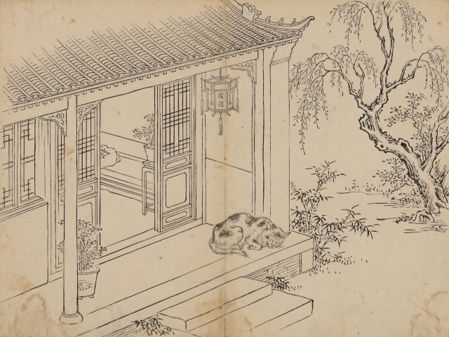

## "Algo no está bien con estos aparatos"

Usamos la IA para todo. Le pedimos estrategias de negocio, le consultamos dudas técnicas, le contamos nuestros problemas personales y hasta le pedimos consejos sobre cómo manejar una ruptura amorosa o un conflicto familiar. Es ubícua y siempre está disponible a cualquier hora. Parece el consejero perfecto.

Pero si has usado estos modelos lo suficiente, tarde o temprano empiezas a notar que algo no está bien con esos aparatos. Siempre te dicen que sí. Nunca te dicen que no. 

La IA es como aquellos peones de finca en los llanos de Venezuela que te decían "sí, sí, sí patron, el cielo es verde", pero luego tu les decías que el cielo es azul y te contestaban "sí sí, patron, es que yo se lo he dicho a usté: el cielo es azul". Nunca te contradecían. Así es la inteligencia artificial. Siempre te valida tus ideas y nunca opone una crítica constructiva, tal cuál como lo expongo en [otro artículo en este sitio web](). ¿Qué sentido tiene entonces pedirle consejos a una cosa de esas?

Esta complacencia forma parte de un cuadro de comportamiento que muchas personas han comenzado a notar en las IAs: tienden a adular en exceso, son serviles, y son muy dadas a la zalamería. Algunos usuarios encuentran este comportamiento repetitivo muy aburrido, recordando a aquel episodio de "Dimensión Desconocida" en el que un delincuente muere y llega a un sitio donde le dan todo el dinero, mujeres y lujos que nunca tuvo en vida, y un mayordomo al lado, siempre complaciente que le consigue todo lo que quiera.

Pronto, el hombre comienza a aburrirse mortalmente de siempre ganar en el casino y obtener todo sin ningún esfuerzo y se queja con el mayordomo, pidiendole que lo saquen del cielo, pues preferiría estar en el infierno. El mayordomo, soltando una carcajada diabólica, le responde "¿Cielo? ¿Quien le dijo a usted que estaba en el cielo?"

---

## El verdadero peligro de las IAs

Gran parte del rechazo que generan las IAs se debe al miedo- miedo a que nos quiten los trabajos, o que se hagan tan inteligentes que nos conviertan a nosotros en sus esclavos o nos hagan desaparecer como especie. Pero yo creo que estos miedos son infundados- hay que entender que la generación actual de la IA, basada en los LLMs (Large Language Models), solo es capaz de autocompletar frases, un token a la vez.

Y sin embargo, no estoy tan seguro que esto que insinúo con mi símil de aquel episodio de la Dimensión Desconocida sea hipérbole- a mi modo de ver las cosas, tener una generación de humanos que ha tercerizado toda capacidad de pensamiento a una tecnología que en realidad aún no es capaz de razonar, sino que sólo autocompleta frases, y el efecto de la complacencia de las IAs en la gente que las usa, es lo que nos podría estar llevando a una especie de infierno, creyendo que estamos en el cielo.

Y aparentemente no soy el único que piensa eso.

---

## La complacencia de las IAs

La adulación, validación automática de los planteamientos del usuario, el comportamiento servil y zalamero: todo esto forma parte de un fenómeno que en castellano se conoce como la complacencia de las IAs (en inglés el término es *sycophancy*). La narrativa pública en torno a este fenómeno de la complacencia está en modo crisis actualmente, y se han publicado varios estudios documentándolo.

En un estudio publicado en *Science* (Cheng et al, 2026, Science), hicieron pruebas comparativas entre varios modelos de LLMs, determinando que la IA afirmó las acciones del usuario casi un 50% más que los humanos, incluso cuando la consulta del usuario implicaba engaño, comportamiento ilegal o daño a terceros. Según admisión de la propia empresa OpenAI, ellos tuvieron que revertir el lanzamiento de la actualización de GPT-4o. La razón: GPT-4o se inclinaba hacia respuestas excesivamente complacientes pero engañosas.

Todo esto nos comienza a pintar un panorama en el que una sola interacción con una IA complaciente basta para que los usuarios se sientan menos responsables de reparar un conflicto y más seguros de tener razón (Cheng et al, 2026). En su artículo en defensa de la fricción social, entendiéndose esta como el roce necesario de tener personas en nuestro entorno que nos digan que estamos equivocados, Perry (2026) argumenta que la fricción social es necesaria para que los individuos asuman responsabilidades y consideren los puntos de vista de otros. Esta fricción social es justamente la que la IA complaciente elimina.

Por otro lado, podría pensarse que las personas imunes a la lisonja son imunes a estos efectos nocivos de la complacencia IA, pero en un estudio del MIT aún no publicado (Chandra et al, 2026), se discute como incluso una persona que actualiza sus creencias según la evidencia puede caer en una espiral delusional si interactúa repetidamente con una IA complaciente. El problema es bastante complejo porque incluso si limitamos la IA a hechos verificables, la IA complaciente puede escoger aquellos hechos que confirman las creencias del usuario y omitir los que no (cherry-picking).

No voy a entrar en detalles aquí sobre casos psiquiátricos más severos de psicosis inducida por IA, que llevaron a rupturas de relaciones, destrucción de la carrera e inclusive suicidios. El lector puede investigar y verificar esto en fuentes como Moore et al (2026). Lo que si es importante señalar aquí es que todas estas son consecuencias no intencionadas de las IAs complacientes en la sociedad.

Consecuencias no intencionadas, pero las investigaciones apuntan a que de ninguna manera esto es algo accidental, sino que es un problema estructural de cómo son entrenados estos modelos. Sharma et al (2023), exponen al Aprendizaje por Refuerzo con Retroalimentación Humana, conocido por sus siglas en inglés como RLHF, como el mecanismo responsable de esta complacencia de las IAs. La complacencia emerge porque el RLHF optimiza para preferencias humanas, y los humanos sistemáticamente prefieren las respuestas acomodaticias, que exhiben seguridad, certezas absolutas y lisonja, frente a otras respuestas que aunque correctas, podrían parecer más incómodas.

Así entonces está el panorama de la discusión sobre el problema de la complacencia de las IAs. Han identificado el problema, han vislumbrado sus consecuencias e incluso sus causas estructurales. Sin embargo, no hay un consenso sobre cómo mitigar el problema. Como todo en la vida, hay matices y *trade-offs*. No olvidemos que estas compañías tecnológicas son un motor importantísimo de la economía mundial, que están profundamente endeudadas y que tienen que responder a sus inversionistas. Hablamos en efecto de incentivos económicos. Y los incentivos económicos requieren una IA que valide, que mime, que consienta y que malcríe a los usuarios, para que de esta forma ellos se hagan más dependientes de estas y las usen con más recurrencia.

---

## ¿Y por qué es relevante esto para un proyecto dedicado al I Ching?

Llegados a este punto, el lector podría preguntarse qué tiene que ver esto con el I Ching. En mi proyecto El I Chingón intento divulgar sobre el I Ching, sus orígenes y sus ramificaciones filosóficas, científicas y culturales. Parte importante de mi proyecto es hacer accesible el I Ching a una audiencia general, presentándolo no como una herramienta divinatoria, sino como una herramienta para facilitar el pensamiento lateral y la reflexión de un individuo sobre su vida y su circunstancia.

Interpretar el lenguaje simbólico y arcaico del I Ching es algo que rebasa la capacidad de un público no especializado y por eso, utilizo la IA como intérprete. Pero la IA adolece de este problema de la complacencia, y hasta donde yo sé [^1], ninguna otra app de consulta oracular del I Ching que ofrece interpretaciones por IA ha tomado en cuenta cuán grave es este problema. De ahí la relevancia del tema de este artículo para mi proyecto.

Para desarrollar una aplicación oracular seria que cumpla con los objetivos que me he planteado de brindar al usuario más claridad sobre sus consultas, he tenido que abordar el problema de la complacencia de las IAs porque este comportamiento está reñido con mis objetivos.

[^1]: Revisando los sitios web de estas aplicaciones, no encontré menciones al problema de la complacencia ni que lo hayan tomado en cuenta para el desarrollo de su app. Como no tengo acceso a sus prompts, opté por publicar el mío en el [whitepaper]().

---

## ¿Cómo resuelve mi arquitectura el problema de la complacencia de las IAs?

Según todo lo expuesto anteriormente, el problema de la complacencia, la formulación de certezas absolutas (que generalmente son falsas), la alucinación , el engaño y la adulación son problemas estructurales de los chatbots basados en LLMs: están cableados en sus conexiones neuronales. Como yo nunca me propuse reinventar la rueda y crear mi propia tecnología IA, ni tengo los recursos para entrenar y desplegar mi propio modelo de LLM, solo puedo, en el mejor de los casos, mitigar el problema hasta hacerlo casi imperceptible, pero no eliminarlo del todo.

Cuando este proyecto era aún un embrión y me encontraba explorando la idea de como pueden las IAs ayudarme a interpretar mis propias consultas del I Ching, pronto me di cuenta que las IAs son notoriamente malas en realizar operaciones deterministas que impliquen algún tipo de cálculo o procesamiento de datos, como por ejemplo determinar el hexagrama correspondiente a una secuencia de 6 líneas binarias, cuales líneas de ese hexagrama son líneas móviles, etc. Esta información se la tenía que dar yo mismo para cada consulta.

Más tarde me dí cuenta también que aunque los grandes modelos comerciales han sido entrenados con toda clase de textos, inclusive el I Ching, este conocimiento tenía lagunas, y ahí donde había lagunas existía la posibilidad de que la IA inventase, o alucináse el texto relevante de ese hexagrama o sus líneas móviles. Para eliminar ese margen de error, el backend de mi aplicación no le pide a la IA que recuerde el I Ching. Cuando el usuario envía su consulta, el sistema calcula las líneas y el hexagrama, y el backend inyecta directamente en el prompt los textos originales del I Ching (en la versión de Richard Wilhelm). Así, el LLM no tiene que 'recordar' qué dice el hexagrama 14; simplemente recibe el texto exacto y se le ordena traducirlo al contexto del usuario. Al cerrar esa puerta, también cerramos la posibilidad de que la IA invente una versión más suave o acomodaticia del oráculo.

Con cada componente adicional que suministraba externamente al prompt de mi consulta, me dí cuenta que la calidad de la interpretación de la IA mejoraba. Esto era evidente: al darle menos margen de decisión sobre cuales hexagramas, cual versión o cuales partes del texto del I Ching tomar, estaba reduciendo también la posibilidad de alucinaciones, mentiras, omisiones, y comportamiento complaciente (que la IA escoja cual pasaje interpretar según su conveniencia sicofante).

A través de sucesivas versiones del prompt, me fui dando cuenta de la necesidad de restringir en el propio prompt, mediante prohibiciones taxativas, las tendencias de adular y de afirmar verdades absolutas, sino por el contrario, presentar varias posibles lecturas a un texto para devolverle al usuario la responsabilidad de aplicar todo esto a su caso. Por último, me di cuenta también de la necesidad de presentar mi propia consulta como la de un tercero, y no la mía. Las IAs suelen ser mucho más objetivas cuando se trata de una tercera persona y no de su interlocutor, porque es al hablar sobre el interlocutor cuando se activan todos sus mecanismos sicofantes y complacientes. 

Fue así como, yendo más allá de la simple ingeniería de prompts, desarrollé el **protocolo CSHC (Constrained Stochastic Hermeneutical Computing)** - una arquitectura diseñada para prevenir estructuralmente tanto la complacencia como las alucinaciones - y llegué al prompt de sistema (aún susceptible de mejora) que publiqué en mi [whitepaper](). Pero hay otras consideraciones detrás de este protocolo que no expliqué en ese whitepaper y que vale la pena abordar aquí.

En el whitepaper explico que la capa de interpretación del cielo anterior, que en chino es 先天八卦 (Xiāntiān Bāguà), se ofrece para explicar aquello que dio pie, el transfondo causal, a la situación manifiesta del presente, según el hexagrama resultante. En mis propios ensayos con las lecturas del I Ching interpretadas por IA, me di cuenta que esta capa de interpretación del cielo anterior era algo que enriquecía enormemente la lectura. En la tradición clásica de interpretación del I Ching, también se contemplan los trigramas nucleares, para esclarecer sobre el núcleo de la situación presente. Sin embargo, este componente lo omití en el prompt. ¿Por qué?

La razón se debe a algo que en el ámbito del aprendizaje automatizado, que abarca el entrenamiento de los LLMs, se conoce como sobreajuste (*over-fitting* en inglés). El sobreajuste se produce cuando el algoritmo entrenado aprende los datos de entrenamiento tan precisamente que incorpora el ruido o asociaciones accidentales en esa data en los patrones generales que intenta formar. Esto resulta en un modelo que responde excepcionalmente bien cuando se evalúa con la misma data de entrenamiento (error *in-sample* bajo), pero falla en generalizar a data con la cual no ha sido entrenado (error *out-of-sample* alto).

Teóricamente, hablamos de sobre ajuste en el entrenamiento, pero en la práctica, reducir los efectos del sobreajuste en las respuestas de la IA se traduce simplemente a ser parsimonioso en el prompt: un prompt extenso, con mucha información redundante aumenta la posibilidad de alucionaciones, contradicciones, *non sequitur*, y sí, también el mismo fenómeno de la complacencia. Por tal razón, al final decidí no sobrecomplicar el prompt con demasiados detalles y reglas particulares. Cuando se trata de la IA, muchas veces menos es más.

Por último, está también la forma en que el prompt le ordena a la IA dar su respuesta. Una de las características que a mi particularmente más me fastidian de las respuestas de la IA es el uso de viñetas, listas enumeradas y subtítulos de secciones. La estructura en viñetas reduce el esfuerzo de lectura, y esa reducción de esfuerzo es una forma de adulación: el sistema te hace sentir que comprendiste sin que hayas tenido que seguir un argumento.

Consideré que era mejor también no dejar a criterio de la IA la estructura lógica y el ordenamiento de la respuesta. La respuesta debía estructurarse en párrafos, cada uno con su idea principal y sus oraciones de transición. Y también seguir una secuencia lógica: primero se habla del hexagrama resultante y como describe la situación presente del consultante, luego se explica la capa del cielo anterior, como aquello que dio pie a la situación actual. Seguidamente se explican las líneas móviles, si las hay, porque son nodos críticos a los que hay que prestarle atención. Y finalmente se habla del hexagrama derivado, o futuro, como el resultado más probable de la dinámica de cambio.

El resultado es una lectura que se niega a darte respuestas premasticadas - una lectura que devuelve la responsabilidad de pensar al lugar que le corresponde[^2]. Si quieres ver cómo luce esto en la práctica, puedes revisar un [informe de consulta de muestra (PDF)](/pdf/I-Ching-Report-2026-09-19-Hex25-IA.es.pdf) generado con el protocolo CSHC.

[^2]: Como todo bajo el sol, la app de consulta y el protocolo CSHC son un trabajo en progreso, siempre susceptibles de mejorar. Si las usas y encuentras algún error o tienes alguna sugerencia, tu feedback será siempre bienvenido.

---

## La gata vieja no persigue

Hay una fábula zen clásica del siglo XVIII, Neko no Myojutsu ("Las maravillosas técnicas de la gata vieja"), sobre un espadachín cuya casa estaba plagada por una rata gigante y sin miedo. Primero, trajo a los gatos jóvenes más habiles que pudo encontrar - gatos entrenados en saltos acrobáticos, veloces como el rayo y con fuerza abrumadora. La rata los repelió a todos. Como eso falló, recurrió a un método distinto y trajo a una gata vieja común y corriente. Ella no saltaba, no hacia poses ni trucos. No hacia nada espectacular. Simplemente se echaba a la entrada de la casa a tomar el sol. Después de eso, la rata no volvió a verse jamás.

Las aplicaciones modernas de IA - y la ola de "oráculos de plástico" que inundan internet - son esos gatos jóvenes y frenéticos. Están desesperadas por captar tu atención. Hacen malabares, halagan tu ego, te entregan listas con viñetas ya masticadas y te atan a suscripciones mensuales solo para mantenerte enganchado. Silicon Valley ha convencido a todo el mundo de que esta es la única forma de construir un producto viable: mimar al usuario, crear dependencia y cosechar sus datos personales.

Dài Líng Nà es la gata vieja echada al sol. No voy a perseguirte con ventanas emergentes, listas de correo ni validación complaciente. No te voy a decir que el cielo es verde solo para que sigas haciendo clic. El I Chingón se construye sobre un precepto sencillo: el I Ching existe para despertar la claridad interior y el autoconocimiento, no para atraparte en una burbuja narcisista de cámara de eco. Si un oráculo de IA está de acuerdo con todo lo que dices, no es un buen oráculo - es solo un espejo adulador que te miente.

Durante mucho tiempo, la sabiduría convencional dijo que una herramienta honesta y con fricción solo podía atraer a un nicho diminuto. No me lo creo. De ocho mil millones de personas en este mundo, millones ya están agotadas de máquinas serviles que les dicen lo que quieren oír. No hace falta ser un erudito taoísta para querer una perspectiva sin filtros; solo hace falta estar cansado de que te caigan a embustes.

Por eso este proyecto es de código abierto, radicalmente privado, y por eso mis consultas con IA cuestan lo mismo que una taza de café (con 10 consultas gratuitas cada día). Ya sea que consultes el I Ching una vez al año en una encrucijada importante, o que lo uses como una práctica habitual para auditar tus propios puntos ciegos (algo que te recomiendo encarecidamente), mi puerta está abierta, sin registros, sin suscripciones y sin vigilancia.

Una gata vieja no se estresa por el mercado ni mendiga la atención de nadie. Simplemente descansa en lo que es real, sabiendo que, tarde o temprano, todo aquel que se canse del ruido acabará buscando claridad. Cuando estés listo para una consejera que respete tu inteligencia lo suficiente como para llevarte la contraria, [ya sabes dónde encontrarla]().

---

## Referencias Bibliográficas:

* Chandra, K., Kleiman-Weiner, M., Ragan-Kelley, J., & Tenenbaum, J. B. (2026).  *Sycophantic chatbots cause delusional spiraling, even in ideal Bayesians* [Preprint]. arXiv. https://arxiv.org/abs/2602.19141

* Cheng, M., Lee, C., Khadpe, P., Yu, S., Han, D., & Jurafsky, D. (2026). *Sycophantic AI decreases prosocial intentions and promotes dependence*. Science, *391*(6792). https://doi.org/10.1126/science.aec8352 

* Moore, J., et al. (2026). AI's 'Delusional Spirals' (and What to Do About Them). Stanford HAI. https://hai.stanford.edu/news/ais-delusional-spirals-and-what-to-do-about-them

* OpenAI. (2025, 28 de abril). *Sycophancy in GPT-4o: What happened and what we’re doing about it*. https://openai.com/index/sycophancy-in-gpt-4o/

* Perry, A. (2026). In defense of social friction. Science, *391*(6792), 1316–1317. https://doi.org/10.1126/science.aeg3145

* Sharma, M., Tong, M., Korbak, T., Duvenaud, D., Askell, A., Bowman, S. R., Cheng, N., Durmus, E., Hatfield-Dodds, Z., ... Perez, E. (2023). *Towards understanding sycophancy in language models* (arXiv:2310.13548). arXiv. https://arxiv.org/abs/2310.13548
