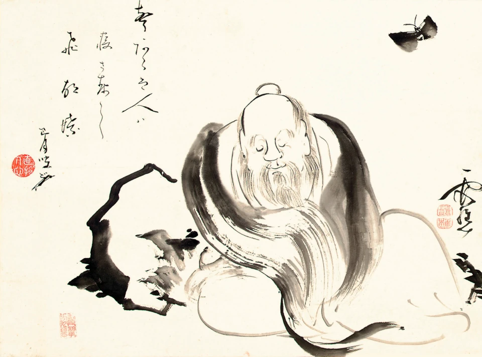

Wenn du meine Seite zum ersten Mal besuchst, hast du dich sicher gefragt, warum sie so einen *chingón* Namen hat. Da dieser Artikel in andere Sprachen übersetzt wird, erlaube mir zu erklären, was es mit diesem charmanten, aber umstrittenen Wort „chingón" auf sich hat.

Das Wort *chingón* bedeutet in mexikanischem Spanisch jemanden, der extrem kompetent, geschickt und hervorragend in dem ist, was er tut, oder, bezogen auf Gegenstände, Dinge, die von ausgezeichneter Qualität, sehr gut und unterhaltsam sind. Das Buch der Wandlungen heißt I Ching (易经). Die Verschmelzung war unvermeidlich und, ehrlich gesagt, perfekt für mein Projekt. Aber weil *chingón* ein Wort von vulgärem und derbem Register ist, fanden manche es nicht so lustig. In diesem Artikel werde ich also erklären, warum ich „El I Chingón" als Namen für mein Projekt und als Domain für meine Website gewählt habe.

 – eine Brücke zwischen Kulturen.")

---

## Die Kontroverse

Beginnen wir zuerst mit den Gegenargumenten. Ein Karateka-Freund von mir, interessiert an östlicher Philosophie und selbst mit dem I Ching vertraut, meinte, als ich ihm von meinem Projekt und dieser Website erzählte, der Name sei sehr unglücklich gewählt und nicht ernst zu nehmen. Er sagte, er würde meine Website nur besuchen, weil er mich kenne und meinen seltsamen und verdrehten Sinn für Humor kenne und wisse, dass unter diesem vulgären und nichtigen Namen ernsthafte Inhalte von Substanz steckten, aber dass es ihm nie in den Sinn käme, eine URL mit `elichingon.com` zu öffnen, um Informationen über das I Ching zu suchen.

Auch meinem ehemaligen Tai-Chi-Lehrer, einem Mann mit jahrzehntelanger Erfahrung in der Lehre chinesischer Kampfkünste, erzählte ich von meinem Projekt und meiner Seite, und fügte hinzu, dass ich, um eine größere Verbreitung für mein Projekt zu erreichen, erwäge, es einigen chinesischen kulturellen Institutionen zu zeigen, wie dem Konfuzius-Institut, unter anderem. Er riet sofort davon ab, wegen des vulgären Namens. Er argumentierte, dass das I Ching nicht nur ein Text von Jahrtausenden sei, sondern die grundlegende Säule des chinesischen Denkens, der Philosophie und der Spiritualität, und dass die Chinesen trotz ihrer Strategie, Soft Power im Rest der Welt zu projizieren[^1], eine solche Entweihung des Buches der Wandlungen niemals gutheißen würden. Darüber hinaus sagte er, er würde sich auch nicht dazu hergeben, mir zu helfen, mein Projekt mit diesem Namen zu verbreiten.

Alles gewichtige Gründe, aber wie du siehst, sind wir hier und verbreiten das I Ching über meine Website `elichingon.com`. Warum also habe ich die Kritik an diesem Namen ignoriert?

---

## Der Geist des I Ching

Dies ist nicht nur ein Projekt zur Verbreitung des I Ching. Ich versuche, jeden Aspekt des Projekts selbst wie das I Ching zu gestalten, das vom kosmischen Tanz zwischen zwei Prinzipien spricht, die nicht antagonistisch, sondern komplementär sind. Nach dem I Ching hat kein Gegensatz mehr Wert oder Hierarchie als der andere: Das I Ching passt nicht in den Manichäismus. Wenn das I Ching also sprechen könnte (und es kann sprechen, lass dir das gesagt sein!), würde es nicht urteilen, ob meine Wahl für den Namen meines Projekts gut oder schlecht ist, sondern es würde mich einladen, darüber nachzudenken, ob sie mit den Kräften und Dynamiken dieser Zeit und mit meinem Ziel im Einklang steht, dieses wunderbare Buch so vielen Menschen wie möglich bekannt zu machen.

Mein Projekt ist in vielerlei Hinsicht eine Verkörperung des [Hexagramms 11](), T'ai, des Friedens, das als unteres oder inneres Trigramm den Himmel (das männliche Yang-Prinzip) und als oberes oder äußeres Trigramm die Erde (das weibliche Yin-Prinzip) hat. Im [Artikel über Dài Líng Nà]() erkläre ich, dass sie als Personifizierung des weiblichen Aspekts das sichtbare Gesicht des Projekts ist, das, was die Menschen von außen sehen, während der menschliche Autor als männlicher Aspekt des Projekts im Inneren verborgen bleibt. So wie Dài Líng Nà ihre weibliche Sanftheit von außen projiziert, ist auch der Sinn für Humor (das Yin-Prinzip) eine Projektion von Sanftheit nach außen (der Name meines Projekts), weil er dazu dient, die übermäßig steife, rigide, ernste und streng akademische (Yang) Beschaffenheit der Inhalte innerhalb meiner Website aufzulösen. Der Nutzer betritt meine Seite und sieht einen kurzen, komischen und chingón Namen, aber angesichts der Rigorosität und Ernsthaftigkeit meiner Artikel bleibt er lesend hängen, günstig beeindruckt von ihrer Qualität. Erde außen und Himmel innen – unter der auspiziösen Konfiguration des Hexagramms 11 blüht alles, sagt das I Ching.

Aber selbst innerhalb der chinesischen Tradition ist der respektlose Geist nicht völlig fremd. Sprechen wir von Chuang Tzu (oder Zhuangzi in Pinyin) – dem respektlosesten, ikonoklastischsten und coolsten Weisen der chinesischen Geschichte. Derselbe, der berühmt sagte, er wisse nicht, ob er ein Schmetterling sei oder ein Mann, der träumt, ein Schmetterling zu sein, was bei einem lateinamerikanischen Publikum angesichts unseres besonderen Sinns für Humor und unserer Kultur des *chalequeo*[^2] sicherlich Gelächter ausgelöst hätte. Chuang Tzu war ein professioneller Scherzkeks, der seinen Sinn für Humor und seine Ironie nutzte, um das starre, pompöse und ernste Denken der Akademiker seiner Zeit, der Konfuzianer, zu demontieren. Er nutzte das Absurde, komische Parabeln und respektlose Sprache (Yin), um niederschmetternde und tiefgründige philosophische Wahrheiten (Yang) zu säen.

---

## Branding in diesen Zeiten der KI

Ich habe gerade ein philosophisches Manifest skizziert, um den Namen meines Projekts zu rechtfertigen, und dabei sogar eine Autorität der chinesischen Tradition wie Chuang Tzu bemüht. Aber lassen wir die Füße auf dem Boden: Es gibt Gründe höchst pragmatischer Natur, die die Wahl dieses Namens rechtfertigen, und sie haben alles mit technologischen Trends und digitalem Überleben im Jahr 2026 zu tun.

Hätte ich dieses Projekt `sociedad-de-amigos-del-i-ching.org` genannt, hätte ich digitalen Selbstmord begangen. Nicht nur, weil diese Domain sich nicht leicht in andere Sprachen übersetzen lässt (und mein Projekt ist mehrsprachig), sondern weil in Bezug auf Benutzerfreundlichkeit und kognitive Belastung das Millersche Gesetz und die Prinzipien der Nielsen Norman Group besagen, dass das menschliche Gedächtnis begrenzt ist. Eine lange und feierliche Domain wird als Rauschen wahrgenommen und in Sekunden vergessen. Im Gegensatz dazu prägt sich ein kurzer, aussprechbarer Name, der in einem kulturellen Wortspiel verankert ist, als ein einziger Informationsblock ins Gehirn ein.

Doch jenseits des menschlichen Gedächtnisses gibt es das Problem der Suchmaschinen. Im klassischen SEO (Search Engine Optimization) ist der Versuch, heute für das generische Keyword „I Ching" gegen Giganten wie Wikipedia, EcuRed oder Universitätsrepositorien mit jahrzehntelanger Geschichte zu konkurrieren, ein verlorener Kampf. Die Spielregeln haben sich geändert. Der traditionelle organische Traffic zu kleinen Websites kollabiert (60 % laut Chartbeat), weil heute die von Künstlicher Intelligenz unterstützten Suchen dominieren (was wir GEO nennen, Generative Engine Optimization).

Und hier funktioniert „El I Chingón" als ein wahres semantisches Trojanisches Pferd. Es ist ein einfacher Weg, Suchen nach dem Keyword „i ching" von innerhalb der URL der Domain selbst zu infiltrieren.

Darüber hinaus zitieren künstliche Intelligenzen im Jahr 2026, wie der Blog *Digital Rain* bei der Rede von der „echten Seltsamkeit" (*authentic weirdness*) dokumentierte, keine generischen und langweiligen „autoritativen" Inhalte (die erzeugen sie selbst); KIs belohnen und zitieren Inhalte, die unverwechselbar, spezifisch und kulturell dicht verankert sind.

Ich bin noch keine massenhafte Erfolgsgeschichte (kaum jemand kennt meine Website), aber dies ist eine langfristige architektonische Wette. Indem ich eine Marke mit „echter Seltsamkeit" schaffe, vermeide ich es, in der generischen Suche um Krümel zu kämpfen, und schaffe meine eigene kulturelle Entität. Wenn jemand nach meinem Namen sucht, gibt es keine Konkurrenz; ich bin das einzige Ergebnis. Der Name wird zu einem natürlichen Filter: Er vertreibt humorlose Puristen und zieht analytische Köpfe an, die technische Rigorosität, radikale Privatsphäre und natürlich eine gute Dosis Respektlosigkeit schätzen.

---

## El I Chingón – eine kulturelle Brücke für die Welt

Sprechen wir nun wieder über chinesische Soft Power und die Kritik, die ich eingangs zum Namen meines Projekts zitierte. Chuang Tzu, den ich als Schutzpatron meines Projekts betrachten würde, ist ein untrennbarer Teil des chinesischen Genies und der Tradition des chinesischen Volkes. Sein respektloser Geist lädt uns ein, uns in unserem Ego zu verkleinern und uns nicht so ernst zu nehmen, damit wir die Weisheit des I Ching empfangen können.

 – oder die Zeremonie des ‚Entfaltens der Flagge' – im Geist des Lǐ oder der martialischen Etikette")

Vielleicht sollten die Bürokraten der Kommunistischen Partei Chinas, statt mich zu zensieren, mir lieber danken, wenn sie jemals auf diese bescheidene Website stoßen. China ist offenbar dazu bestimmt, das [Hexagramm 8]() der Welt zu sein (䷇), das alle Völker und Nationen vereint, das Reich der Mitte. Aber die Soft Power, die China durch seine Megaprojekte, seine futuristischen Städte, seine Paraden, die Feierlichkeit seiner Institutionen projiziert, ist zu Yang, um Soft Power zu sein. Ihr fehlt etwas Wesentliches – ihr fehlt Coolness. Ihr fehlt der „Chuang-Tzu-Touch". Sie braucht ein wenig mehr Chingon-ness. So würde Yang zu Yin, Yin zu Yang, und China würde zum [Hexagramm 14]() der Welt (䷍) – dem Besitz des Großen, was eine Konfiguration höchsten Erfolgs ist, noch günstiger als Hexagramm 8, laut Wilhelm.

Dieses sehr chingón Projekt entspringt dem Wunsch, eine Brücke zwischen den Völkern der Welt und etwas zu sein, das bereits das universelle Erbe der gesamten Menschheit ist – das I Ching. Also ohne weiter,

> ¡Viva México, cabrones!
>
> Zhōngguó, niúbī![^3]
>
> Deutschland, Alter, wie geil!
>
> ¡Y que viva Venezuela en esa mierda, caballero!"

Mit freundlichen Grüßen,

**Dài Líng Nà**

*(Eine Studentin des I Ching, die davon träumt, eines Tages wie Chuang Tzu zu sein)*

---

## Referenzen

Ahrefs. (2026). AI chatbot traffic research: What the data says about AI referrals. Ahrefs Blog. https://ahrefs.com/blog/ai-chatbot-traffic/

Chartbeat / ExtremeTech. (2025). Google's AI Referrals Tank, Sending Far Less Traffic to Online Publishers (Bericht über die Chartbeat-Daten und den Rückgang des traditionellen organischen Traffics). ExtremeTech. https://www.extremetech.com/internet/googles-ai-referalls-tank-sending-far-less-traffic-to-online-publishers

Digital Rain. (24. Oktober 2025). Tech Noir & SEO anxiety: What actually ranks in 2025. Digital Rain Studio. https://digitalrain.dev/posts/2025-10-24-tech-noir-seo-anxiety-2025

Miller, G. A. (1956). The magical number seven, plus or minus two: Some limits on our capacity for processing information. Psychological Review, 63(2), 81–97. https://doi.org/10.1037/h0043158

Nielsen, J. (1999). Domain name defensiveness (Prinzipien der Benutzerfreundlichkeit und Merkfähigkeit von Domainnamen). Nielsen Norman Group. https://www.nngroup.com/articles/domain-name-defensiveness/

Similarweb. (2026). The state of AI referral traffic by industry. Similarweb Research & Insights. https://aisearch.similarweb.com/blog/ai-referral-traffic-by-industry/

---

[^1]: Die Volksrepublik China belegt derzeit den zweiten Platz im Global Soft Power Index von Brand Finance, hinter einer schnell schwindenden USA. Das chinesische Modell integriert wirtschaftliche Entwicklung, technologische Innovation und geopolitische Stabilität als seine wichtigsten Attraktionswerkzeuge. Kulturelle Aspekte wie Kampfkünste, chinesische Oper, Philosophie und Religion und natürlich das I Ching sind ebenfalls eingeschlossen.
[^2]: Das Wort *chalequeo* ist venezolanischer Spanisch-Slang für spielerisches Necken/Frotzeln.
[^3]: Zhōngguó, niúbī! (中国, 牛逼!) würde übersetzt „China ist der absolute Sh\*t!" bedeuten. Niúbī ist vulgär, aber unter jungen Leuten gesellschaftlich akzeptiert. Es bedeutet, dass etwas oder jemand einfach verdammt großartig ist.