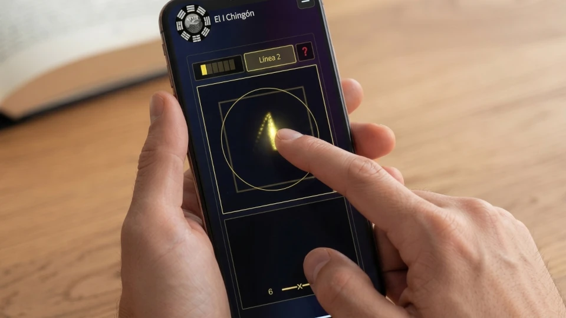

Gegenstände zu verlieren gehört zu den häufigsten Situationen des Alltags. Es ist zugleich äußerst stressig und lässt uns Zeit verlieren, fast immer dann, wenn wir es am eiligsten haben. Wir könnten natürlich eine klassische I-Ging-Konsultation durchführen, um verlorene Gegenstände zu finden, und solche Konsultationen können uns Hinweise anhand der Bilder in den Hexagrammtexten geben. Doch das I Ging auf klassische Weise zu befragen ist nicht die effizienteste Methode, um verlorene Gegenstände zu finden. Wusstest du, dass es eine Wahrsagemethode gibt, die auf dem I Ging basiert und speziell für diese Art von Situation entwickelt wurde?

Diese Wahrsagemethode heißt Liu Yao, auch bekannt als Wen Wang Gua oder Sechs-Linien-Methode. Tatsächlich handelt es sich um eine Familie von Methoden mit verschiedenen Varianten je nach Anwendung: zur Diagnose von Krankheiten oder energetischen Blockaden, zur Bewertung von Paar- oder zwischenmenschlichen Beziehungen, für berufliche oder geschäftliche Entscheidungen und natürlich zum Auffinden verlorener Gegenstände, worum es hier geht.

In diesem Artikel erklären wir kurz, wie du unsere Orakel-App auf Basis der Liu-Yao-Methode verwenden kannst, um verlorene Gegenstände zu finden. Diese App führt dich Schritt für Schritt, ermöglicht dir das Werfen der Hexagrammlinien und erstellt einen Bericht für deine Konsultation. Wir werden die Theorie der Methode nicht erklären (das heben wir für andere Artikel auf, die sich an interessierte Leser richten). Hier geben wir nur praktische Hinweise zur Verwendung unserer App, um deinen verlorenen Gegenstand zu finden.

## Die Konsultation in der App vorbereiten

Du kannst die App über diesen [Link]() oder über die Schaltfläche "Orakelkonsultation" im Hauptmenü der Website öffnen. Du siehst ein Formular wie dieses:

Dort gibst du den Gegenstand ein, den du suchst, zum Beispiel "Autoschlüssel". Im Feld darunter gibst du etwas Kontext an, zum Beispiel: "Ich weiß nicht, ob ich sie zu Hause oder im Büro gelassen habe, oder vielleicht im Laden, als ich kurz etwas kaufen wollte." Im Kontext ist es hilfreich zu klären, ob du im Namen einer anderen Person fragst oder ob der Gegenstand dir gehört, wo du ihn zuletzt gesehen hast und jedes andere Detail, das hilft, den Verlust einzuordnen. Je mehr Kontext du gibst, desto aussagekräftiger wird die Antwort der KI sein, die deine Konsultation interpretiert. Aber sei auch kurz und gib nur die wichtigsten Informationen.

Es lohnt sich, ein Detail zu erwähnen: Die Liu-Yao-Methode gibt oft Richtungen an, in denen sich der Gegenstand befinden könnte, ausgedrückt in Himmelsrichtungen (Norden, Süden, Osten, Westen, Nordosten usw.). Deshalb ist es nützlich, im Kontext die relative Ausrichtung der Orte anzugeben, die du erwähnst. Wenn du zum Beispiel sagst, dass du nicht weißt, ob die Schlüssel zu Hause oder im Büro geblieben sind, ist es hilfreich hinzuzufügen, dass das Haus im Westen und das Büro im Osten liegt. So kannst du, wenn das Orakel eine bestimmte Richtung nahelegt, diesen Hinweis mit den Orten abgleichen, die du kennst.

Schließlich verlangt die Methode die Angabe der Kategorie des verlorenen Gegenstands. Die richtige Kategorie zu wählen ist wichtig, denn davon hängt ab, ob die Lesung auf die richtige Linie des Hexagramms zeigt.

Wenn du zwischen zwei Kategorien schwankst, frage dich, was die Hauptfunktion des Gegenstands ist. Ist es ein Dokument oder ein Werkzeug, das dir ermöglicht, in der Welt zu funktionieren? Dann gehört es zu Dokumente und Infrastruktur. Ist es Reichtum, etwas, das an sich einen materiellen Wert hat? Dann gehört es zu Wertgegenstände. Ist es ein Tier? Dann gehört es zu Tiere und Haustiere. Ist es ein Gegenstand des persönlichen, alltäglichen Gebrauchs, der weder Dokument noch Reichtum noch Tier ist? Dann gehört es zu Gegenstände des täglichen Gebrauchs.

Dies sind die vier verfügbaren Kategorien:

* **Dokumente und Infrastruktur**: Papiere, Hefte, Schlüssel, Ausweisdokumente, Geldbörse mit Dokumenten und Karten, Fahrzeuge.

* **Wertgegenstände**: Bargeld, Schmuck, teure Uhren, Telefon, Geldbörse mit Geld und ohne Dokumente.

* **Tiere und Haustiere**: Hunde, Katzen, Vögel, jedes verlorene Tier.

* **Gegenstände des täglichen Gebrauchs**: Brille, Sonnenbrille, Regenschirm, Stift, Ladegerät, Kopfhörer, Kleidung, leerer Rucksack.

## Das Werfen erzeugen (die Linien der Hexagramme)

Sobald alle Informationen über den verlorenen Gegenstand in das Formular eingegeben wurden, bringt dich ein Klick auf die gelbe Schaltfläche "Konsultation beginnen" zum Bildschirm der Entropieerfassung. Dort musst du mit dem Finger Striche auf dem Touchscreen ziehen (oder mit der Maus, wenn du einen Desktop-PC verwendest), bis die Schaltflächen aktiviert werden, um die sechs Linien nacheinander zu erzeugen. Auf diese Weise werden die 6 Linien des Hexagramms erzeugt, die die Liu-Yao-Methode erfordert.

Es ist wichtig anzumerken, dass der Prozess der kinästhetischen Entropieerfassung — das digitale Äquivalent auf unserer Website zum traditionellen Münzwurf oder zur Manipulation der Schafgarbenstängel — ein echtes Ritual darstellt. Dies erfordert, dass der Fragende seine Aufmerksamkeit fest auf seine Frage richtet und eine ruhige, empfängliche Grundhaltung einnimmt; ein Geisteszustand, der ohnehin bereits die Lösung des dem Orakel vorgetragenen Problems begünstigt. Mehr dazu kannst du in [diesem Artikel]() lesen.

Wenn du eine Lesung auf Basis eines Wurfs erstellen möchtest, den du zu einem früheren Zeitpunkt gemacht hast, vielleicht mit deinen eigenen Münzen, dann musstest du auf dem vorherigen Bildschirm (dem Hauptformular) die Erweiterte Optionen aufklappen und "Manuell" auswählen. Unter dieser Option musst du das Datum angeben, an dem du diese frühere Konsultation durchgeführt hast, da es nicht unbedingt das aktuelle Datum ist. Das Datum korrekt anzugeben ist entscheidend für eine korrekte Lesung, da die Liu-Yao-Wahrsagemethode das Datum der Konsultation als Datum verwendet.

## Der Ergebnisbildschirm

Sobald der Wurf vollständig ist, mit dem resultierenden Hexagramm und seinen sechs Linien, zeigt die Anwendung ein zweites Formular an, mit dem du einen kostenlosen PDF-Bericht herunterladen kannst.

Dieser kostenlose PDF-Bericht enthält die wesentlichen Daten der Konsultation und die Tabellen, die als Grundlage für die Liu-Yao-Analyse dienen. Diese Tabellen sind für Menschen, die dieses Wahrsagesystem kennen, aber für die breite Öffentlichkeit, die konsultiert, ist es ideal, einen vollständigen Bericht der Konsultation herunterzuladen, der die KI-Interpretation enthält. Dieser vollständige Bericht kostet einen (1) Credit.

Die KI-Interpretation übersetzt die Tabellen des kostenlosen Berichts in eine einfache Sprache: Sie sagt dir, ob der Gegenstand nah oder fern ist, ob er bedeckt oder sichtbar ist, in welche Richtung es sich lohnt zu suchen und welche Art von Orten du überprüfen solltest. Es ist im Wesentlichen eine Wahrscheinlichkeitskarte, kein Versprechen, dass du finden wirst, was du suchst.

## Wie man die Hinweise liest und was zu tun ist, wenn man nichts findet

Der von der App erstellte Bericht ist kein Satz wie "er liegt unter dem Sofa, in der nordöstlichen Ecke". Liu Yao funktioniert nicht so. Was du bekommst, ist eine Wahrscheinlichkeitskarte, und diese Karte muss sorgfältig gelesen werden.

Das Erste ist die Richtung. Die Methode gibt normalerweise Himmelsrichtungen an, und das ist ein wertvoller Hinweis, aber es ist kein GPS. Wenn die Lesung "Osten" sagt, bedeutet das nicht, dass der Gegenstand genau östlich von dir liegt. Es bedeutet, dass der wahrscheinlichste Suchbereich in dieser Ausrichtung liegt. Wenn du im Kontext der App gesagt hast, dass dein Büro im Osten liegt, wird dieser Hinweis viel konkreter. Wenn du keine Richtungsangabe gemacht hast, ist die Richtung allgemeiner und sollte mit den Orten abgeglichen werden, die du kennst.

Das Zweite ist der Zustand des Gegenstands. Die Linie, die ihn repräsentiert, kann in verschiedenen Zuständen erscheinen: blühend, schwach, leer, im Grab, bedeckt, sichtbar. Wenn die Lesung sagt, dass er leer oder im Grab ist, ist der Gegenstand wahrscheinlich verborgen, von etwas bedeckt oder außer Sichtweite. Wenn sie sagt, dass er blühend ist, kann er sichtbar, in der Nähe, offen vor Augen sein. Das sagt dir, wie du suchen solltest: Wenn er bedeckt ist, schau unter Dingen, in Schubladen, zwischen Papieren nach. Wenn er sichtbar ist, überprüfe Oberflächen, Durchgangsorte, was auf Augenhöhe liegt.

Das Dritte ist die Beziehung zum Konsultanten. Die Linie des Gegenstands kann den Konsultanten begünstigen, stützen, unter Druck setzen oder festhalten. Wenn der Gegenstand "den Konsultanten begünstigt", ist die Suche tendenziell einfach, der Gegenstand erscheint fast mühelos. Wenn er "den Konsultanten unter Druck setzt", kann die Suche angespannt, frustrierend, mit Hindernissen sein. Das ändert nicht, wo der Gegenstand ist, aber es sagt dir, was du vom Prozess erwarten kannst: Wenn die Lesung Spannung nahelegt, ist es am besten, ruhig zu suchen, ohne sich zu versteifen, denn Angst vernebelt den Blick.

Und das Vierte ist das Ganze. Die Lesung ist kein einzelner Hinweis, sie ist eine Kombination. Die Richtung, der Zustand, die Beziehung, der Kontext, den du angegeben hast, alles wird zusammen gelesen. Konzentriere dich nicht auf ein einzelnes Element und verwirf den Rest. Wenn die Richtung Osten sagt, der Zustand bedeckt sagt und der Kontext sagt, dass das Haus im Osten liegt, dann orientiert sich die Suche zum Haus, und innerhalb des Hauses zu den Orten, an denen der Gegenstand bedeckt sein könnte: eine Schublade, eine Kiste, ein niedriges Möbelstück.

Wenn du nach all dem nichts findest, gibt es mehrere Dinge, die du tun kannst. Das Erste ist, den Ansatz zu ändern. Höre auf, an den offensichtlichen Orten zu suchen, und überprüfe die Durchgangsorte, die Ecken, in die du normalerweise nicht schaust, die niedrigen Möbel, die Dinge, die sich ohne Ordnung ansammeln. Das Zweite ist, zu fragen. Wenn zum Zeitpunkt des Verlusts Menschen anwesend waren, hat jemand den Gegenstand vielleicht unbemerkt bewegt oder ihn weggelegt in der Annahme, dir einen Gefallen zu tun. Das Dritte ist, zu warten. Manchmal erscheint der Gegenstand, wenn du aufhörst, ängstlich nach ihm zu suchen. Die Lesung kann anzeigen, dass er in der Nähe ist, aber dass du Ruhe brauchst, um ihn zu sehen. Und das Vierte ist, an einem anderen Tag erneut zu konsultieren. Die Methode ist nicht unfehlbar, und manchmal hilft ein zweiter Blick, mit mehr Kontext oder mit einer anderen Frage, die Suche zu verfeinern.

Das Wichtigste ist, nicht zu vergessen, dass die App nicht verspricht, dass du finden wirst, was du suchst. Sie bietet eine Landkarte der wirkenden Kräfte, und diese Landkarte ist am nützlichsten, wenn du sie mit deinem eigenen Gedächtnis, deiner eigenen Beobachtung und deiner eigenen Ruhe kombinierst. Einen verlorenen Gegenstand zu finden, geht nicht nur um den Gegenstand. Es geht darum, das Gefühl wiederzuerlangen, dass die Welt noch in deiner Reichweite ist, und sei es auch nur ein wenig.

[Zur App zur Suche nach verlorenen Gegenständen]()