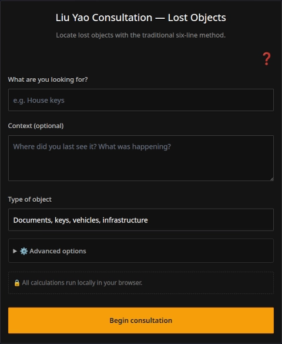

Losing objects is one of the most common situations in daily life. It is also deeply stressful becuase it makes us waste time almost always when we least can afford to. While we could certainly perform a classic I Ching consultation to help us find lost objects, and such consultations can give us clues based on the images in the hexagram texts, consulting the I Ching in the classic way is not the most efficient method for finding lost objects. Did you know that there is a divination method based on the I Ching specifically designed for this kind of situation?

This divination method is called the Liu Yao method, also known as Wen Wang Gua or the six-line method. It is, in fact, a family of methods with different variants depending on their application: diagnosing illnesses or energetic blockages, evaluating romantic or interpersonal relationships, making career or business decisions, and of course, finding lost objects, which is the use we are concerned with here.

In this article, we will briefly explain how to use our oracle consultation app based on the Liu Yao method to find lost objects. This app guides you step by step, allowing you to cast the lines of the hexagram and generating a report for your consultation. We will not explain the theory behind the method (we leave that for other articles aimed at curious readers). Here we will only give you practical guidance on how to use our app to find your lost object.

## Preparing the consultation in the app

You can open the app through this [link]() or from the "Oracle Consultation" button in the main menu of the site. You will see a form like this:

On that form, you indicate the object you are looking for, for example "car keys". In the field below, you provide some context, for example: "I don't know if I left them at home or at the office, or maybe at the store when I got out to buy something." As you enter the context, it helps to clarify whether you are consulting on behalf of another person or whether the object is yours, where you last saw it, and any other details that can provide clues. The more context you provide, the more informative the response from the AI that interprets your consultation will be, but keep in mind that providing too much information can be detrimental, so only add the essential details.

One detail is worth mentioning: the Liu Yao method often provides directions where the object may be found, expressed as cardinal points (north, south, east, west, northeast, etc.). For this reason, it is useful to indicate in the context the relative orientation of the places you mention. For example, if you say you don't know whether the keys were left at home or at the office, it helps to add that the house is to the west and the office is to the east. That way, if the cast suggests a specific direction, you can cross-reference that clue with the places you know.

Finally, the method requires indicating the category of the lost object. Choosing the right category is important, because the reading depends on it pointing to the correct line of the hexagram.

If you are unsure between two categories, ask yourself what the main function of the object is. Is it a document or a tool that allows you to function in the world? Then it goes in Documents and infrastructure. Is it wealth, something that has material value in itself? Then it goes in Valuables. Is it an animal? Then it goes in Animals and pets. Is it an object of personal, everyday use, that is neither a document nor wealth nor an animal? Then it goes in Common use objects.

These are the four available categories:

* **Documents and infrastructure**: Papers, notebooks, keys, identity documents, wallet with documents and cards, vehicles.

* **Valuables**: Cash, jewelry, expensive watches, phone, wallet with money and no documents.

* **Animals and pets**: Dogs, cats, birds, any lost animal.

* **Common use objects**: Glasses, sunglasses, umbrella, pen, charger, headphones, clothing, empty backpack.

## Generating the cast (the lines of the hexagrams)

Once all the information about the lost object has been entered in the form, clicking the yellow button that says "Begin consultation" takes you to the entropy capture screen, where you must draw strokes with your finger on the touchscreen (or with the mouse, if you are using a desktop PC) until the buttons become enabled to generate the six lines successively. In this way, you generate the 6 lines of the hexagram required by the Liu Yao one by one.

It is important to note that the kinesthesic entropy capture process —the digital equivalent on our site to the traditional casting of coins or the manipulation of yarrow stalks— constitutes a true ritual. This requires the consultant to maintain a focused attention on their question, alongside a calm and receptive mindset, a state of mind that in itself already favors the resolution of the problem presented to the oracle. You can read more about this in [this article]().

If you want to generate a reading based on a cast you made on a previous date, perhaps with your own coins, then on the previous screen (the main form), you needed to expand the Advanced options and select "Manual". Under this option, you must indicate the date on which you made that previous consultation, since it will not necessarily be the current date. Indicating the date correctly is critical for a correct reading, since the Liu Yao divination method uses the date of the consultation as data.

## The results screen

Once the cast is complete, with the resulting hexagram and its six lines, the application displays a second form, which allows you to download a free PDF report.

This free PDF report contains the essential data of the consultation and the tables that serve as input for the Liu Yao analysis. These tables are for people who know this divination system, but for the general public who consult, the ideal is to download a complete report of the consultation that includes the AI interpretation. This complete report costs one (1) credit.

The AI interpretation translates the tables of the free report into plain language: it tells you whether the object is near or far, whether it is covered or in plain sight, in which direction it is worth searching, and what type of places to check. It is, in essence, a map with probabilities, not a promise that you will find what you are looking for.

## How to read the clues and what to do if you find nothing

The report generated by the app is not a phrase like "it's under the sofa, in the northeast corner". Liu Yao does not work that way. What you get is a map of probabilities, and that map must be read carefully.

The first thing is direction. The method usually indicates cardinal points, and that is a valuable clue, but it is not a GPS. If the reading says "east", it does not mean the object is exactly east of where you are. It means the most probable search area is in that orientation. If in the context you told the app that your office is to the east, that clue becomes much more concrete. If you gave no directional reference, the direction is more general and should be cross-referenced with the places you know.

The second thing is the state of the object. The line that represents it can appear in different conditions: prosperous, weak, empty, in tomb, covered, exposed. If the reading says it is empty or in tomb, the object is probably hidden, covered by something, or out of sight. If it says it is prosperous, it may be exposed, nearby, in plain sight. That tells you how to search: if it is covered, check under things, inside drawers, between papers. If it is exposed, check surfaces, places of passage, what is at eye level.

The third thing is the relationship with the consultant. The line of the object can favor the consultant, sustain them, pressure them, or retain them. If the object "favors the consultant", the search tends to be easy, the object appears almost effortlessly. If it "pressures the consultant", the search may be tense, frustrating, with obstacles. That does not change where the object is, but it tells you what to expect from the process: if the reading suggests tension, it is best to search calmly, without obsessing, because anxiety clouds the sight.

And the fourth thing is the whole. The reading is not a single clue, it is a combination. The direction, the state, the relationship, the context you provided, everything is read together. Do not focus on a single element and discard the rest. If the direction says east, the state says covered, and the context says the house is to the east, then the search is oriented toward the house, and inside the house, toward the places where the object may be covered: a drawer, a box, a low piece of furniture.

If after all this you find nothing, there are several things you can do. The first is to change your approach. Stop searching in the obvious places and check the places of passage, the corners you don't usually look at, the low furniture, the things that accumulate without order. The second is to ask. If there were people around at the time of the loss, someone may have moved the object without realizing it, or may have put it away thinking they were doing you a favor. The third is to wait. Sometimes the object appears when you stop searching for it anxiously. The reading may indicate that it is nearby, but that you need calm to see it. And the fourth is to consult again another day. The method is not infallible, and sometimes a second look, with more context or with another question, helps refine the search.

The important thing is not to forget that the app does not promise that you will find what you are looking for. It offers a map of the forces at play, and that map is most useful when you combine it with your own memory, your own observation, and your own calm. Finding a lost object is not only about the object. It is about recovering, even just a little, the sense that the world is still within your reach.

[Go to the lost objects search app]()