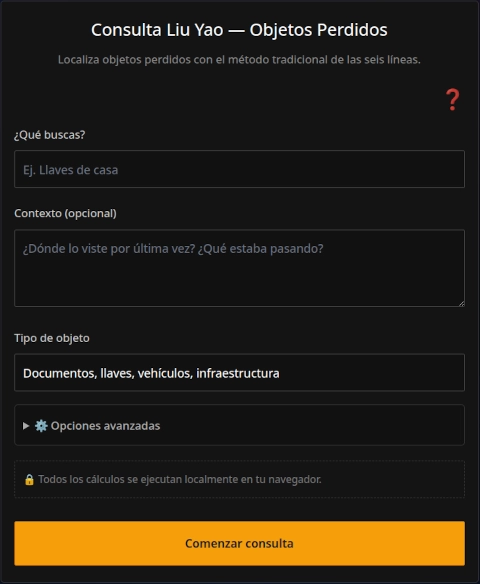

Perder objetos es una de las situaciones más comunes de la vida cotidiana, que además es sumamente estresante y nos hace perder tiempo, casi siempre cuando estamos más apurados. Si bien podríamos hacer una consulta clásica al I Ching para ayudarnos a encontrar objetos perdidos y estas consultas nos pueden dar pistas según las imágenes de los textos de los hexagramas, consultar al I Ching según la manera clásica no es la manera más eficiente para encontrar objetos perdidos. ¿Sabías que existe un método divinatorio basado en el I Ching específicamente para este tipo de situaciones?

Este método divinatorio se llama el método Liu Yao, que también es conocido como Wen Wang Gua o método de las seis líneas. En realidad, es una familia de métodos con distintas variantes según sus aplicaciones: para diagnosticar enfermedades o bloqueos energéticos, evaluar relaciones de pareja o interpersonales, toma de decisiones laborales o de negocios, y por supuesto, encontrar objetos perdidos, que es el uso que nos ocupa aquí.

En este artículo, vamos a exponer brevemente cómo usar nuestra app de consulta oracular basada en el método Liu Yao para encontrar objetos perdidos. Esta app te lleva de la mano, permitiéndote hacer la tirada de las líneas del hexagrama y generando un informe de la consulta para ti. No vamos a explicar la teoría del método (eso lo dejamos para otros artículos para los lectores interesados). Aquí solo vamos a dar orientaciones prácticas sobre cómo usar nuestra app para encontrar su objeto perdido.

## Preparando la consulta en el app

Puedes abrir el app mediante este [enlace]() o desde el botón de "Consulta oracular" en el menú principal de la página. Verás un formulario como éste:

Desde ahí, indicas el objeto que buscas, por ejemplo "llaves del carro". En el campo de abajo das un poco de contexto, por ejemplo: "no sé si las deje en la casa o en la oficina, o quizás en la tienda cuando me baje a comprar algo." En el contexto, conviene aclarar si estás consultando por otra persona o si el objeto es tuyo, dónde lo viste por última vez, y cualquier otro detalle que ayude a situar la pérdida. Mientras más contexto proporciones, más informativa será la respuesta de la IA que interpreta tu consulta, pero también sé breve y solo proporciona la información clave.

Conviene también mencionar un detalle: el método Liu Yao suele proporcionar direcciones donde posiblemente se encuentre el objeto, expresadas como puntos cardinales (norte, sur, este, oeste, noreste, etc.). Por eso es útil que indiques en el contexto la orientación relativa de los lugares que mencionas. Por ejemplo, si dices que no sabes si las llaves quedaron en la casa o en la oficina, conviene añadir que la casa está al oeste y la oficina al este. Así, si la tirada sugiere una dirección concreta, puedes cruzar esa pista con los lugares que conoces.

Por último, el método exige indicar la categoría del objeto perdido. Elegir bien la categoría es importante, porque de eso depende que la lectura apunte a la línea correcta del hexagrama. 

Si dudas entre dos categorías, pregúntate cuál es la función principal del objeto. ¿Es un documento o una herramienta que te permite funcionar en el mundo? Entonces va en Documentos e infraestructura. ¿Es riqueza, algo que tiene valor material por sí mismo? Entonces va en Objetos de valor. ¿Es un animal? Entonces va en Animales y mascotas. ¿Es una cosa de uso personal y cotidiano, que no es documento ni riqueza ni animal? Entonces va en Objetos de uso común.

Estas son las cuatro categorías disponibles:

* **Documentos e infraestructura**: Papeles, libretas, llaves, documentos de identidad, cartera con documentos y tarjetas, vehículos.

* **Objetos de valor**: Dinero, joyas, relojes caros, teléfono, cartera con dinero y sin documentos.

* **Animales y mascotas**: Perros, gatos, aves, cualquier animal perdido.

* **Objetos de uso común**: Lentes, gafas de sol, paraguas, bolígrafo, cargador, audífonos, ropa, mochila vacía.

## Generando la tirada (las líneas de los hexagramas)

Una vez suministrada toda la información sobre el objeto extraviado en el formulario, al darle clic al botón amarillo que dice "Comenzar consulta", la aplicación te lleva a la pantalla de captura de entropía, donde debes hacer trazos con el dedo sobre la pantalla táctil (o con el ratón, si usas una PC de escritorio) hasta que se habiliten los botones para ir generando las seis líneas sucesivamente. De esta forma, se generan las 6 líneas del hexagrama que el método Liu Yao requiere.

Es importante señalar que el proceso de captura de entropía kinestésica - el equivalente digital en nuestro sitio al lanzamiento tradicional de monedas o a la manipulación de los tallos de milenrama - constituye un auténtico ritual. Para ello, se requiere que el consultante mantenga una atención plena en su pregunta, así como una actitud serena y receptiva, un estado mental que de por sí ya favorece la resolución del problema planteado al oráculo. Puedes leer más sobre esto en [este artículo]().

Si quieres generar una lectura en base a una tirada que hiciste en una fecha previa, quizás con tus propias monedas, entonces en la pantalla previa (el formulario principal), tenías que desplegar las Opciones avanzadas y seleccionar "Entrada manual". Bajo esta opción, debes indicar la fecha en que hiciste esa consulta previa, ya que no necesariamente será la misma fecha actual. Indicar la fecha correctamente es crítico para una lectura correcta, ya que el método de adivinación Liu Yao utiliza la fecha de la consulta como dato.

## La pantalla de los resultados

Al tener una tirada completa, con el hexagrama resultante y sus seis líneas, la aplicación despliega un segundo formulario, que te permite descargar un informe PDF gratuito. 

Este informe PDF gratuito contiene los datos esenciales de la consulta y las tablas que sirven de insumo al análisis de Liu Yao. Estas tablas son para personas que conocen este sistema divinatorio, pero para el común de la gente que consulta, lo ideal es descargar un informe completo de la consulta que incluye la interpretación por IA. Este informe completo tiene un costo de un (1) crédito.

La interpretación por IA traduce las tablas del informe gratuito a un lenguaje sencillo: te dice si el objeto está cerca o lejos, si está cubierto o a la vista, en qué dirección conviene buscar, y qué tipo de lugares revisar. Es, en esencia, un mapa de probabilidades, no una promesa de que encontrarás lo que buscas.

## Cómo leer las pistas y qué hacer si no encuentras nada

El informe que genera la app no es una frase del tipo "está debajo del sofá, en la esquina noreste". El Liu Yao no funciona así. Lo que obtienes es un mapa de probabilidades, y ese mapa hay que saber leerlo.

Lo primero es la dirección. El método suele indicar puntos cardinales, y esa es una pista valiosa, pero no es un GPS. Si la lectura dice "este", no significa que el objeto esté exactamente al este de donde estás. Significa que la zona de búsqueda más probable está en esa orientación. Si en el contexto le dijiste a la app que tu oficina queda al este, esa pista se vuelve mucho más concreta. Si no le diste ninguna referencia direccional, la dirección es más general y conviene cruzarla con los lugares que conoces.

Lo segundo es el estado del objeto. La línea que lo representa puede aparecer en distintas condiciones: próspera, débil, vacía, en túmulo, cubierta, expuesta. Si la lectura dice que está vacía o en túmulo, el objeto probablemente está oculto, cubierto por algo, o fuera de la vista. Si dice que está próspera, puede estar expuesta, cerca, a la vista. Eso te dice cómo buscar: si está cubierta, revisa debajo de cosas, dentro de cajones, entre papeles. Si está expuesta, revisa superficies, lugares de paso, lo que está a la altura de los ojos.

Lo tercero es la relación con el consultante. La línea del objeto puede favorecer al consultante, sostenerlo, presionarlo o retenerlo. Si el objeto "favorece al consultante", la búsqueda tiende a ser fácil, el objeto aparece casi sin esfuerzo. Si "presiona al consultante", la búsqueda puede ser tensa, frustrante, con obstáculos. Eso no cambia dónde está el objeto, pero te dice qué esperar del proceso: si la lectura sugiere tensión, conviene buscar con calma, sin obsesionarse, porque la ansiedad nubla la vista.

Y lo cuarto es el conjunto. La lectura no es una sola pista, es una combinación. La dirección, el estado, la relación, el contexto que tú diste, todo se lee junto. No te fijes en un solo elemento y descartes el resto. Si la dirección dice este, el estado dice cubierto, y el contexto dice que la casa está al este, entonces la búsqueda se orienta hacia la casa, y dentro de la casa, hacia los lugares donde el objeto pueda estar cubierto: un cajón, una caja, un mueble bajo.

Si después de todo esto no encuentras nada, hay varias cosas que puedes hacer. La primera es cambiar el enfoque. Deja de buscar en los sitios obvios y revisa los lugares de paso, los rincones que no sueles mirar, los muebles bajos, las cosas que se acumulan sin orden. La segunda es preguntar. Si había gente en el momento de la pérdida, alguien pudo haber movido el objeto sin darse cuenta, o haberlo guardado pensando que te hacía un favor. La tercera es esperar. A veces el objeto aparece cuando dejas de buscarlo con ansiedad. La lectura puede indicar que está cerca, pero que necesitas calma para verlo. Y la cuarta es volver a consultar otro día. El método no es infalible, y a veces una segunda mirada, con más contexto o con otra pregunta, ayuda a afinar la búsqueda.

Lo importante es no olvidar que la app no promete que encontrarás lo que buscas. Ofrece un mapa de las fuerzas en juego, y ese mapa es más útil cuando lo combinas con tu propia memoria, tu propia observación y tu propia calma. Encontrar un objeto perdido no se trata solo del objeto. Se trata de recuperar, aunque sea un poco, la sensación de que el mundo sigue estando a tu alcance.

[Ir a la aplicación de búsqueda de objetos perdidos]()