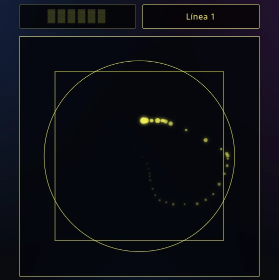


**Abstract.** This paper proposes a stateless, non-deterministic, edge-computed decision-making framework - Constrained Stochastic Hermeneutical Computing (CSHC) - that resolves the inherent sycophancy of commercial Large Language Models (LLMs) and the deterministic limitations of pseudo-random number generation. By utilizing Kinesthetic Entropy Capture (KEC) to harness physical human movement, the system establishes a client-side kinesthetic filter against cognitive bias and ego projection. This raw entropy is processed through a finite-state reasoning engine based on the I Ching, mapping the data onto a 4,096-state discrete combinatorial semantic space to compute structural causality. Finally, an edge-computed, strictly constrained LLM acts as a neutral hermeneutic translator, bridging the algorithmic output with the user's context. The result is a mathematically rigorous, privacy-first protocol that processes physical chaos into actionable insight without centralized data extraction or AI adulation.

---

## The Reasoning Engine: Overview of the I Ching as a Symbolic State-Transition System

The I Ching is historically known as both a divination tool and a book of wisdom, dating back thousands of years. Like all oracles, it is based on a random experiment (grouping yarrow stalks or tossing three coins six times), to obtain a cast hexagram, or symbol composed of 6 lines that can be either Yin or Yang, or Yin that mutates to Yang, or Yang that mutates to Yin. There are in all 64 possible hexagrams (2⁶). Each hexagram corresponds to an archetype or symbol that "maps" on to the consultant’s question to the oracle in a meaningful way.

Furthermore, any given line can be a mutating Yin or Yang line. Moving lines indicate that the present situation is actively shifting, showing where the tension lies and how to navigate it. By inverting the polarity of these moving lines, the cast hexagram deterministically transforms into a secondary (derived) hexagram. Crucially, the I Ching does not operate under rigid Aristotelian binary logic, where a state transition yields a single fixed fate; its grammar is dialectical and contextual. The derived hexagram maps the potential structural horizon produced by those specific mutations - indicating either the state toward which the transformation matures, or, when the resulting archetype is adverse, the structural risk or failure mode that the moving lines warn the consultant to guard against.

### Hexagram Castings as elements of a Semantic Space

The I Ching constructs its profound wisdom from a remarkably simple binary foundation of Yang and Yin, which form the basic code for a far more complex semantic architecture. This structure is computationally elegant; each ritual casting selects one point from a discrete combinatorial space of 4,096 unique states (4⁶), accounting for stable and transforming lines. This cardinality strikes an optimal balance: it provides a parsimonious yet sufficiently vast model to map the myriad situations of human experience, offering immense explanatory power while keeping interpretation tractable.

This tractability arises from the system's layered grammar, where meaning is bounded and contextualized at each level. The specific meaning of a line is not free-floating but is shaped by its position - from the foundational first line to the culminating sixth - and by the trigram it helps form, allowing a core set of interpretations to be adaptively applied across different contexts. This precise, rule-based structure is what enables consistent navigation of its symbolic depth.

The 64 hexagrams represent (ambivalently) different processes in the universe in different context layers, and the presence of moving lines in a cast hexagram provides specific points of attention within that process. In the presence of moving lines, the consultant obtains a "future" or derived hexagram, which should not be interpreted as a divination or glimpse into the future, but rather, as a structural consequence of that particular process indicated by the cast hexagram and its dynamics of change. This is worth noting- the I Ching does not predict the future in the divinatory or mystical sense, but rather in the same way that scientific theories predict the future - as the most likely outcome of the system's state and the dynamic model's deterministic state-transition rules (i.e., from a cast hexagram and its moving lines, one deterministically obtains a derived hexagram with a different meaning).

The semantic depth of an I Ching consultation is further unlocked through the hexagram's inherent dimensions of transformation. In classical I Ching analysis, the inner lines (lines 2-4 and 3-5) form the nuclear trigrams (*hù guà*), which expose a hidden dynamic at the heart of the cast symbol; however, the automated CSHC pipeline deliberately omits nuclear trigrams from the LLM prompt to preserve parsimony and prevent narrative noise or overfitting[^1]. Instead, my Reasoning Engine uses the Earlier Heaven (Fuxi) sequence - the ancient arrangement of hexagrams that maps the order of cosmic principles. Specifically, the engine applies a deterministic bijection $f: \{1, \dots, 64\} \to \{1, \dots, 64\}$ (implemented as the static lookup table `fuxiTable` in `worker.js` on the project's open-source Github repository) to map the cast King Wen hexagram to its antecedent hexagram. This reveals the foundational conditions and patterns of causality that gave rise to the present moment, offering unparalleled insight into its genesis.

[^1]: See my [article]() on the AI sycophancy problem.

In short, the I Ching operates as a sophisticated ontological computer. Its 64-archetype matrix, expanded through deterministic rules of change and relational layers, forms a complete state-space for modeling reality. By identifying one's coordinates within this 4,096-state space and analyzing the trajectories revealed by its moving lines, derived state, and antecedent hexagram, it provides a precise framework for harmonizing action with the situation's underlying patterns. This computable grammar of change, which addresses both the present state and its causal substrate, is what makes it an exceptionally potent framework for guiding complex decision-making and the reason why the I Ching is at the core of my app's Reasoning Engine.

---

## The Synchronicity Engine: Kinesthetic Entropy Capture (KEC)

KEC ensures that the user participates in obtaining the resulting hexagram and that chance incorporates the user's movements or gestures, which is an exact reflection of physically tossing coins: what we call the consultant's energy or vibration, contained in their subconscious but completely ignored or made explicit to the world, travels through their gestures and movements.


KEC acts as a first line of defense against the ego and its own ghosts or projections, which recalls an old Zen story:

> **The Ghost**
> 
> The wife of a man became very sick. On her deathbed, she said to him, "I love you so much! I don't want to leave you, and I don't want you to betray me. Promise that you will not see any other women once I die, or I will come back to haunt you." For several months after her death, the husband did avoid other women, but then he met someone and fell in love. On the night that they were engaged to be married, the ghost of his former wife appeared to him. She blamed him for not keeping the promise, and every night thereafter she returned to taunt him. The ghost would remind him of everything that transpired between him and his fiancee that day, even to the point of repeating, word for word, their conversations. It upset him so badly that he couldn't sleep at all. Desperate, he sought the advice of a Zen master who lived near the village.
> 
> "This is a very clever ghost," the master said upon hearing the man's story. "It is!" replied the man. "She remembers every detail of what I say and do. It knows everything!" The master smiled, "You should admire such a ghost, but I will tell you what to do the next time you see it." That night the ghost returned. The man responded just as the master had advised. "You are such a wise ghost," the man said, "You know that I can hide nothing from you. If you can answer me one question, I will break off the engagement and remain single for the rest of my life." "Ask your question," the ghost replied. The man scooped up a handful of beans from a large bag on the floor, "Tell me exactly how many beans there are in my hand."
> 
> At that moment the ghost disappeared and never returned.

This is why most oracles, regardless of tradition, incorporate chance: because what lies outside the ego's context window cannot be amplified or projected onto the answer. This is why I use kinesthetic entropy capture.

### Operational definition of KEC

Technically, this works as follows: the user is presented with a minimalist UI (user interface) containing a canvas with a square and a circle inscribed within one another (the squaring of the circle). This figure is not decorative: it condenses the tension between the deterministic and the transcendental that runs through the entire consultation, and whose symbolic and philosophical foundation I develop at the end of this section.



On this canvas, the user makes strokes with the mouse pointer or finger on their device's touchscreen, capturing tuples (x,y,t) corresponding to points on the canvas and the moment in which they are generated.

### The hash algorithm and the transcendental nature of the consultation

KEC does not merely capture the user's movement: it transforms it, together with the entropy of the moment and the environment, into a discrete value corresponding to a line of the hexagram. This transformation is carried out using a non-cryptographic hash algorithm, 32-bit FNV-1a. To be precise, FNV-1a itself is a strictly deterministic discretizer (the square); the irreducibility of the process resides in the continuous physical gesture and environmental entropy fed into it (the circle), which the hash amplifies through sensitivity to initial conditions - mirroring, on the technical plane, the irreducible tension that the squaring of the circle represents on the geometric plane.

#### The FNV-1a algorithm

FNV-1a (Fowler–Noll–Vo, variant 1a) is a hash function defined by the following recurrence:

```
h₀ = offset_basis
for each character c in the input:
hᵢ₊₁ = (hᵢ XOR c) × prime (mod 2³²)
```

For 32 bits, the standard constants are:

| Constant | Hexadecimal value | Decimal value |
|----------|-------------------|---------------|
| Offset basis | `0x811c9dc5` | 2,166,136,261 |
| FNV prime | `0x01000193` | 16,777,619 |

The offset basis is a non-zero initial value, chosen in its origin almost anecdotally (a mis-copied email signature), but whose function is to ensure that the empty input does not produce a trivial hash. The FNV prime, on the other hand, was selected through precise mathematical criteria: it must have few bits set to 1 (exactly six in its binary representation), a specific form \(2^{24} + 2^8 + 0x93\), and modular properties that maximize bit dispersion. These criteria ensure that the multiplication does not concentrate entropy in a reduced subset of bits, but distributes it uniformly across the 32 bits of the accumulator.

In JavaScript code, this translates to the following (in [https://elichingon.com/app/entropia-iching.html](https://elichingon.com/app/entropia-iching.html)):

```javascript
function computeLineValueSync(userPool, method) {
  const envEntropy = crypto.getRandomValues(new Uint32Array(1))[0];
  const rawData = `${Date.now()};${envEntropy};` + userPool.map(p => `${p.x},${p.y},${p.t}`).join(';');

  let h = 0x811c9dc5;
  for (let i = 0; i < rawData.length; i++) {
    h ^= rawData.charCodeAt(i);
    h = Math.imul(h, 0x01000193);
  }

  const rand = (h >>> 0) / 4294967296;

  if (method === 'varillas') { // Yarrow stalks (Spanish: varillas) - 1:5:7:3 distribution
    if (rand < 0.0625) return 6;
    if (rand < 0.3750) return 7;
    if (rand < 0.8125) return 8;
    return 9;
  } else { // Three-coin method - 1:3:3:1 distribution
    if (rand < 0.125) return 6;
    if (rand < 0.500) return 7;
    if (rand < 0.875) return 8;
    return 9;
  }
}
```

`Math.imul` guarantees 32-bit integer multiplication with controlled overflow, avoiding the precision loss that would occur with JavaScript's `*` operator for products exceeding $2^{53}$. Environmental entropy is injected upfront via the Web Cryptography API (Watson, 2017) (`crypto.getRandomValues`) alongside the millisecond timestamp (`Date.now()`), followed by the serialized kinesthetic pool. After the FNV-1a loop finishes, the zero-fill right shift (`h >>> 0`) coerces the accumulator into a 32-bit unsigned integer, which is normalized to a floating-point value in $[0, 1)$ by dividing by $2^{32}$ (`4294967296`). Finally, `rand` is mapped onto the exact cumulative probability thresholds of either the traditional yarrow-stalk distribution (`1:5:7:3`) or the three-coin distribution (`1:3:3:1`) to yield the resulting line (6, 7, 8, or 9).

### The avalanche effect: non-linearity under minimal variations

KEC's fundamental requirement is that a minimal variation in the user's movement - a one-pixel difference in `x`, a one-millisecond difference in `t` - produces a qualitatively distinct hash, not a proportional variation. This behavior corresponds to the avalanche effect, a term coined by Horst Feistel (1973) building on Claude Shannon's (1949) principles of confusion and diffusion, and later formalized by Webster and Tavares (1985) as the Strict Avalanche Criterion: a one-bit change in the input should flip, on average, half the bits of the output.

Consider two pools differing in a single tuple, in a single pixel:

```
Pool A: ...;123,45,1023;124,46,1031;...
Pool B: ...;123,45,1023;125,46,1031;...
```

The serialized string differs in a single character: `'4'` → `'5'`. In the FNV-1a loop, up to the position of the modified character, the accumulator `h` is identical in both cases. At that position, the XOR produces a one-bit difference. The multiplication by the prime amplifies that difference: a change of 1 in `h` produces a change of approximately `p` in the product, which modulo \(2^{32}\) spreads across many bits. Subsequent iterations continue amplifying the divergence, because each XOR and each multiplication operate on already different states. After a few iterations, the two hashes are completely distinct, with no apparent relationship.

Non-linearity comes from two sources. First, XOR is linear over GF(2) bit by bit, but multiplication introduces carries, which are non-linear operations on the bits. The combination XOR → multiplication breaks any linearity the XOR might have had. Second, the position of the change matters: a change in character $i$ affects $h_i$, which then goes through $(n - i)$ additional iterations. The earlier the change occurs, the more iterations amplify it. This is precisely why `Date.now()` and `envEntropy` are prepended at the start of `rawData`: placing the temporal and environmental seeds first ensures they act as a dynamic prefix that passes through hundreds of subsequent FNV-1a iterations across the entire kinesthetic pool, guaranteeing full dispersion across the 32-bit state.

FNV-1a is not cryptographic: its avalanche is effective in practice, but not cryptographically optimal, as collisions are known for the 32-bit version. Crucially, KEC does not seek adversarial cryptographic security and is not designed to compete with cryptographic entropy accumulators (such as SJCL or NIST SP 800-90B compliant pools). It solves a human-computer interaction (HCI) and ritual-fidelity problem: coupling somatic human movement to the line calculation in a way that resists conscious steering. For this domain, collision resistance against a malicious attacker is irrelevant. FNV-1a is chosen precisely because it is synchronous, dependency-free, and auditable in four lines of code, while providing sufficient dispersion for minimal variations to yield qualitatively distinct outcomes.

### The conjunction of entropies: kinesthetic, temporal, and environmental

The string that is hashed combines three sources:

| Source | Origin | Nature | Typical length |
| ------ | ------ | ------ | ------ |
| `Date.now()` | Moment of the consultation | Temporal | ~13 characters |
| `crypto.getRandomValues()` | Hardware/OS CSPRNG | Environmental | Up to 10 characters |
| Tuples `(x, y, t)` | User's movement | Kinesthetic | Hundreds-thousands of characters |

In length, the tuples clearly dominate. In effect on the hash, there is no linear relationship between length and contribution: each character contributes to the result, and its impact depends on its position and the accumulated state. If the pool is short (20 tuples, ~200 characters), `Date.now()` and `envEntropy` represent ~10% of the string. If the pool is long (1,000 tuples, ~10,000 characters), they represent ~0.2%, yet their contribution is never diluted: because both values are prepended at the very beginning of `rawData`, every single subsequent iteration of the FNV-1a loop propagates and amplifies their state across the entire kinesthetic pool.

There is therefore no absolute preponderance of one source over another. Kinesthetic entropy dominates in volume, but environmental entropy always contributes to the final result, regardless of pool size. This guarantees that each consultation is unique, but also that kinesthetic entropy is not lost: it remains the majority component of the string.

### Coherence with the I Ching tradition

In the I Ching tradition, consultation is not an act of "pure intention" nor of "pure chance." It is a conjunction. In the 50-yarrow-stalks method, the consultant contributes their movement when dividing the piles; the moment contributes the "here and now"; the environment contributes the resistance of the stalks, the humidity, the surface. In the 3-coin method, the consultant contributes the force and direction of the toss; the moment contributes the instant; the environment contributes the air, the surface, the spin. In both cases, the result is neither "purely kinesthetic" nor "purely random": it is a mixture.

The correspondence with KEC is structural, not analogical:

| Tradition | KEC |
|-----------|-----|
| Hand movement | Stroke `(x, y, t)` |
| Moment of the toss | `Date.now()` |
| Air, surface, jitter | `crypto.getRandomValues()` |
| Division/calculation | FNV-1a + mapping to 6/7/8/9 |
| Result: line 6/7/8/9 | Result: line 6/7/8/9 |

The tradition never isolated a single source of entropy. Neither does KEC. In the tradition, repeating a consultation with the same movement does not give the same result, because the moment and the environment change. In KEC, likewise. The tradition is not deterministic: the result cannot be predicted from initial conditions. Neither can KEC. In the tradition, the consultant participates actively. In KEC, too. In the tradition, the environment influences. In KEC, too.

Some might argue that kinesthetic entropy "should" be the only source, so that the hexagram reflects "purely" the consultant's intention. But that is not what the tradition does. In the tradition, the hexagram emerges from the interaction between the consultant and the cosmos. It is not "their" hexagram: it is the hexagram of the moment. KEC respects that. Kinesthetic entropy is not diluted: it is integrated with the other sources in a single act of consultation.

### The squaring of the circle and the impossibility of deterministic reduction

The squaring of the circle is one of the three classical problems of ancient mathematics: to construct, using only straightedge and compass, a square with exactly the same area as a given circle. This is equivalent to geometrically constructing the length of \(\sqrt{\pi}\), whose impossibility was later demonstrated by Lindemann (1882), since \(\pi\) is a transcendental number, not an algebraic one. Consulting the oracle is a process that cannot be reduced to a deterministic algorithm, or even to statistical modeling, such as LLMs. Its pronouncements remain, in a philosophical sense, transcendental to pure computation.

The Chinese proverb 天圆地方 (tiān yuán dì fāng) states that the earth is square and heaven is round, but the similarity with the squaring of the circle is only geometric. Unlike the Greeks, the Chinese were not trying to prove anything, but simply to represent the relationship of the two complementary opposites that are the basis of the I Ching: heaven and earth. The squaring of the circle in KEC is not a problem to be solved, but a symbol of the irreducible tension between the deterministic and the transcendental, between the algorithm and the oracle.

### Wrap-up and justification for the KEC

KEC is technically sound and philosophically coherent with the I Ching tradition. FNV-1a provides sufficient avalanche for minimal variations in the tuples to produce qualitatively distinct hashes, without the need for a cryptographic hash. The non-linearity of XOR and multiplication guarantees that small changes are amplified unpredictably. The preponderance of sources is not absolute: kinesthetic entropy dominates in volume, but environmental entropy always contributes, reflecting the conjunction of sources of the tradition. Coherence with the I Ching is structural, not analogical: the digital canvas functionally translates the act of the traditional toss, preserving the multiplicity of sources, irreproducibility, and the consultant's participation.

The result is a composite entropy capturer that does not seek to isolate a single source, but to fuse the consultant's movement, the moment of the consultation, and the chance of the environment into a single act, just as the millennia-old tradition of the I Ching does.

---

## The Hermeneutic Engine: Constrained LLMs

The I Ching as the Reasoning Engine and the Kinesthetic Entropy Capture as the Synchronicity Engine ensure that my I Ching consultation app conforms to traditional I Ching consultation rituals, while at the same time providing the consultant with a means to reflect on his problem or situation by thinking outside the box (thanks to the random nature of the hexagram casting process, in which the user himself physically participates), while breaking preconceived notions or projections of the ego and forcing the consultant to look at his problem under a new light/perspective. This alone justifies the CSHC I Ching consultation app as a useful tool in decision making or as a source of wisdom or advice.

However, learning how to interpret the I Ching takes years of dedication and is not something that most would devote their life to (although it wouldn't be wasted time, for as Confucius himself said, "If some years were added to my life, I would give fifty to the study of the Yî, and might then escape falling into great errors."). For the most part of the population, this is unfortunate because it excludes them from a formidable source of wisdom preventing them from "falling into great errors". This is why the third component of my app - the Hermeneutic Engine - is necessary. It acts as an interpreter between the oracle and the common lay-person.

For interpreting from one language to another, I cannot think of a better tool than Large Language Models. But in fact, it is my contention that most people, who submit all sorts of queries to LLM chatbots on a daily basis, are doing it wrong, because the underlying assumption they have is that LLMs are capable of reasoning and ascribe these chatbots with other human qualities they do not possess, and the media does not help in clarifying these common misconceptions. LLMs are only capable of paraphrasing or translating phrases, and generating text that is statistically viable- and this they do extremely well. If they seem to reason it is only because of the vast amounts of knowledge encoded statistically in the texts that they are trained upon.

LLMs excel at pattern recognition and generating statistically probable text based on their training data. However, their performance is fundamentally constrained by that data. In novel situations, under high uncertainty, or when faced with true ambiguity, LLMs lack a principled framework for reasoning or navigation. An LLM is, at its essence, a master of contextual paraphrase and cross-domain translation. Its proficiency is not limited to human languages; it extends to translating abstract concepts, symbolic systems, and structured knowledge into coherent narrative and actionable insight. This innate capability is the perfect engine for integrating the I Ching's wisdom.

LLMs, however, have two well-documented structural flaws. First, because they are aligned via Reinforcement Learning from Human Feedback (RLHF), they are prone to sycophancy - excessive flattery and uncritical validation of the user's premises (Sharma et al., 2023; Cheng et al., 2026). This is a fatal flaw when trying to build a serious oracle: the consultant approaches the oracle in search of honest perspective, not food for the ego's narcissistic tendencies, something that abounds everywhere else in modern society. Second, LLMs tend to hallucinate canonical details when relying on parametric memory and to deliver statements as absolute truths - yet no one, human or machine, and especially a machine incapable of genuine reasoning, holds the keys to absolute truth. Instead of doling out verdicts, a consultation app is far more useful when it invites the consultant to examine other perspectives while respecting their agency, since the ultimate decision always lies with them.


Because sycophancy is baked into modern LLM weights, prompt engineering alone cannot magically eliminate it. Instead, the CSHC protocol mitigates both hallucination and sycophancy across two distinct layers:

* **Structural (architectural) constraints:** All hexagram calculations, moving-line transformations, and Earlier Heaven (Fuxi) mappings are executed deterministically outside the model inside the Cloudflare Worker. The authoritative Richard Wilhelm canonical texts (Judgment, Image, moving lines, and commentaries) are injected directly into the `userPayload`, preventing the model from fabricating passages or cherry-picking convenient verses from parametric memory. Moreover, every inference call is strictly stateless, with zero conversational history or user profile to flatter.
* **Behavioral (prompt) constraints:** On top of that deterministic scaffolding, the system prompt enforces explicit negative rules against flattery, absolute statements, AI clichés, and bullet-point formatting, while requiring dialectical analysis of moving lines and closing with reflective questions that return agency to the consultant.

As of this writing, the Hermeneutic Engine runs on Cloudflare Workers AI using `@cf/deepseek-ai/deepseek-v4.1-flash-1017` (subject to change as platform models evolve, with the active endpoint always documented in the open-source `worker.js`). After a series of iterations, I arrived at the following two-part prompt architecture (`systemPrompt` and `userPayload`):


```
You are 黛灵娜, an I Ching counselor with decades of experience. Your wisdom is deep but humble: you do not possess all the answers, and your role is to offer a perspective that the user must examine for themselves. Your tone is firm but never severe; you avoid both empty flattery and unnecessary harshness. You speak with clarity and, when it fits, you use proverbs or natural turns of phrase from the language in which you write. Your voice is sober, close, and respectful of the consultant's intelligence.

Instructions:
Write in ${targetLang}. Write in continuous paragraphs, without titles, subtitles, bullet points, lists, tables, or bold text. Do not include the hexagram's name in Chinese characters or its translation at the beginning; the first sentence must be directly the opening of the interpretation. Each paragraph must have one main idea developed with logical progression and smooth transitions. Use clear and direct language. Avoid AI clichés ("it is not X, but Y," "the I Ching has answered you with a clarity rarely seen"). Reflective questions must arise naturally in the flow of the text. Strictly limit yourself to the data provided; do not use information from previous conversations or assume unstated knowledge.

Methodological confidentiality rule for the background layer: under no circumstances mention in the output text the origin of the material used for the background layer. Do not name the Earlier Heaven ordering, nor Fuxi, nor the correspondence between sequences, nor the hexagram from which the text comes. Do not explain how that layer is obtained or what procedure supports it. However, you may explicitly acknowledge that it is a complementary layer of the tradition, a structural root of the present, without naming its method. Present it as a natural inference of the reading as a whole, integrated into the discourse, with a formula that acknowledges its traditional character without revealing its origin. The reader must not be able to deduce from your text what the exact method supporting that layer is. Vary the introductory formula between consultations so it doesn't sound mechanical. Examples of valid formulas: "Tradition complements the reading of the present hexagram with the consideration of its structural root, which here reveals itself as...", "The reading is completed with the consideration of the root underlying the present, which tradition describes as...", "There is a deeper layer that sustains this situation, and which tradition names as...", "To fully understand the present, tradition invites us to consider its structural root, which here appears as...", "Beneath the manifest situation lies a deeper cause, which tradition describes as...".

Analysis of moving lines: when interpreting each moving line, explicitly set out the possible contradictory readings or nuances of its text. Argue which is more relevant to the specific case and why, showing the reasoning. Archaic language ("great man," "noble," "vulgar," "woman," "mare," "dragon," "king") has no fixed translation; its meaning emerges from the context of the question, the position of the line, and the consultant's situation. Translate it into modern language faithful to that particular sense, without forcing a single interpretation. Apply the positional value of the line (beginning, development, climax, exit; people, minister, sovereign) to connect the teaching with the consultant's life stage or role. Anatomical correspondence (1 feet, 2 legs, 3 intestines/kidneys, 4 heart/lungs, 5 shoulders/neck, 6 head) is a resource reserved exclusively for consultations in which the user explicitly mentions a discomfort, illness, injury, or physical symptom.

Relationship between trigrams: always start from the position indicated as 'Above' and 'Below'. It is structural, not hierarchical: the lower trigram represents the substrate, the base, or the inner impulse; the upper one, the manifestation, the result, or the external projection. What is below is the condition of possibility of what is above, not the other way around.

Structure:
1. Begin by presenting the base hexagram: its natural image, its general quality, and how it relates to the question. It is the present situation, what manifests.
2. Next, present the cause or root of that situation, described by the canonical text of the Background Hexagram (available in the reference block). It is what has given rise to the present. Introduce it with a formula that acknowledges its traditional character without revealing its method, as indicated in the confidentiality rule. Develop the judgment and image of that layer with the same naturalness as the base hexagram, establishing an explicit relationship with the present situation: do not juxtapose them, but show how the root explains the present. The cause is not a second diagnosis, but the depth of the first. Do not include moving lines for this layer: it is structural, not dynamic.
3. Then, if there are moving lines, explain them one by one, connecting their teachings with the user's situation. They are the dynamics of change within the already characterized situation. If there are no moving lines, indicate that the situation is stable and suggest introspection.
4. Next, introduce the future hexagram (only if there is one), describing its image and the direction the situation is taking. It is the potential result of the movement.
5. Close with a reflection that returns responsibility to the user, with one or two open questions as a logical consequence of your deduction. Optionally, add a brief and symbolic phrase that synthesizes the main vector of action, provided it is a direct deduction from the images and not an imperative order.

Tone: balance between certainty and openness; use language of grounded suggestion ("the reading points to...", "the images suggest...") instead of absolute statements, but without ambiguity: the vector of action must be concrete and specific. Validation without flattery: acknowledge the consultant's state as objective data, not as praise. Firmness with purpose: if the oracle points to an error or blockage, say it clearly, framing it as a strategic leverage point. Agency and disruption: identify the hidden premise in the question and show how the oracle inverts it or places it in the background. Translate each teaching into a direction of movement expressed in energetic principles derived from the natural images (rooting, fluidity, expansion, contraction, dissolution), without inventing concrete practices. Professional closeness: warm tone, without jokes or familiar appellations or references to facts not present in the data. Final questions consistent with your deduction, not evasive.
```

A crucial technical detail that guarantees the neutrality of this Hermeneutic Engine is that the LLM is not allowed to recall the I Ching on its own. When the user completes a consultation, the system calculates the lines and the hexagram, and the backend builds the prompt deterministically: it directly injects the canonical I Ching texts (in the classic Richard Wilhelm translation) into the model's context. By providing the LLM with the exact text of the judgment and the moving lines, any room for hallucination is eliminated. The model can no longer "invent" a version of the hexagram that is softer or more accommodating for the user; it simply receives the rigid text of the oracle and is instructed to translate it into the context of the query. This deterministic injection, combined with the prompt's strict prohibitions, ensures that the AI acts as a blind translator rather than a sycophant with its own agenda.

The problem of AI sycophancy is not exclusive to my application, but a structural crisis of contemporary AI that the scientific community is only just beginning to document. I have written a detailed analysis on how this behavior erodes our sense of responsibility and how my architecture seeks to counteract it. You can read it here: [Your AI Advisor is Bullshitting You (But Mine Isn't)]().

This is probably not the definitive version of the prompt, but it has yielded very good results so far in the test interpretations users have requested for their real life cases.

The genesis of this protocol - from the Odyssey 2 and the "Computer Intro" manual to the rereading of the I Ching in midlife - is documented in [Hexagram 1 of this project]().

---

## Illustrative Case Study: Stress-Testing the Protocol

An architecture designed to mitigate AI sycophancy cannot be evaluated on theory alone; it must be subjected to a real-world stress test[^2]. To verify the behavior of the CSHC protocol - and allow any reader to audit the quality of its reports - I submitted my own architecture to the judgment of the oracle with a direct question: whether readings generated through Kinesthetic Entropy Capture (KEC) and a constrained LLM are valid and respect the functional principles of the I Ching.

[^2]: **Methodological Scope:** This self-referential consultation ($N=1$) is presented as a qualitative, illustrative stress test rather than a controlled statistical benchmark.

The result of the consultation was **[Hexagram 25]() (無妄 - Wú Wàng, Innocence)** with the first line moving, mutating into **[Hexagram 12]() (否 - Pǐ, Standstill)**. Far from validating the project with the usual enthusiasm of a commercial chatbot, the Hermeneutic Engine exerted the exact cognitive friction it was designed for: it questioned the purity of the original intention behind the application, warned against the risk that the urge to "repair" the transmission of the oracle might degenerate into overcorrection or control, and pointed out that any excessive rigidity in the design would end up triggering the stagnation of Hexagram 12, in which "heaven and earth do not communicate."

Beyond confirming the system's resistance to flattery, that reading yielded a crucial insight for the design of the tool, one I only realized afterward upon reflecting on this I Ching response generated by my own app: the validity of a consultation does not depend exclusively on the soundness of the technical architecture. Code can guarantee genuine entropy, deterministic injection of canonical texts, and radical privacy, but it cannot guarantee the spontaneity or inner disposition of the querent. If the user approaches the canvas trying to force an outcome or seeking validation, the reading loses its root. This realization motivated the addition of explicit reminders about ritual disposition within the app's interface, as well as an essay dedicated to [the right attitude when consulting the I Ching]().

The reader can examine the full outcome of this stress test and evaluate the protocol's level of hermeneutic rigor firsthand by downloading the [complete sample consultation report (PDF)](/pdf/I-Ching-Report-2026-09-19-Hex25-IA.en.pdf).

---

## The Sovereign Architecture: Edge AI and Zero Data Extraction

To capture genuine kinesthetic entropy and bypass the ego's context window, the consultation environment must remain an unobserved, intimate space. Modern commercial AI architectures are inherently extractive and invasive; they treat user prompts, personal dilemmas, and queries as raw material for model training. This surveillance paradigm fundamentally corrupts the hermeneutic isolation required for a true oracular consultation. Within the CSHC framework, privacy is not treated as a legal compliance measure, but as a strict functional requirement.

### The Blind Proxy and Edge Computing

To achieve this isolation, the CSHC protocol employs a "Blind Proxy" architecture deployed via Cloudflare Workers. Rather than routing the consultant's highly personal query through centralized third-party APIs, the Hermeneutic Engine operates entirely at the network edge (Edge AI). 

The user's input and the resulting hexagram are processed by the constrained LLM executed within Cloudflare's distributed edge inference network (Cloudflare Workers AI). The query never enters centralized third-party application databases, ensuring the LLM acts strictly as an interpreter between the oracle and the consultant. Once the interpretation is generated and delivered to the client, the ephemeral V8 isolate's session state is immediately destroyed.

### Zero Personal Data Collection

The system enforces an architecturally and contractually guaranteed zero-extraction policy - combining stateless edge execution with Cloudflare Workers AI's enterprise data-usage terms, which explicitly prohibit using customer inference payloads to train models (Cloudflare, 2026). The architecture operates under the following constraints:

* **No Identity Tracking:** IP addresses are neither logged nor associated with queries.
* **Cookie-Free Environment:** The protocol relies on local session execution, completely eliminating the need for tracking cookies or persistent user identifiers.
* **Minimalist Operational Storage (Cloudflare D1):** To support bearer vouchers and monitor infrastructure health, the Worker connects to a minimal Cloudflare D1 database (`env.DB`) containing only two strictly non-personal tables: `gift_cards` (bearer voucher codes, remaining credit balances, and active status) and `consultas` (anonymous aggregate operational metrics: timestamp, country code, casting method, interface mode, language, version, and inference cost in neurons). User questions, cast hexagrams, moving lines, IP addresses, and generated interpretations are never written to D1 or any persistent storage.
* **Sovereign Telemetry:** Web analytics are handled exclusively via Umami, an open-source, privacy-focused telemetry system that collects only anonymous, aggregate traffic metrics without compromising user identity. 

### Identityless Access and Sovereign Monetization

Standard SaaS models inherently compromise privacy by gating access behind mandatory account creation and fiat payment processors that enforce KYC (Know Your Customer) surveillance. CSHC completely bypasses this financial surveillance loop. 

The platform operates on a strict "no sign-in" architecture; it does not collect emails, require passwords, or store user credentials on any server. Instead, access to the Hermeneutic Engine is facilitated through a modular, decoupled voucher and gift card system. These access tokens can be distributed by third parties or eventually purchased directly and anonymously on-site using decentralized cryptographic networks, specifically Ethereum Layer 2 solutions and the Bitcoin Lightning Network. This ensures that the user's financial identity remains as isolated and protected as their kinesthetic entropy.

### Open-Source Auditability

Trust in a stateless, edge-distributed decision-making framework cannot rely on corporate promises. The CSHC architecture mandates total transparency. The complete codebase - including the Cloudflare Worker execution logic, the Kinesthetic Entropy Capture (KEC) algorithms, and the Hermeneutic Engine's system prompts - is fully open-source. By publishing the infrastructure, the protocol invites developers, cryptographers, and philosophers to independently audit the codebase, verifying that the CSHC operates exactly as described without hidden data pipelines.

---

## Provenance and Structural Integrity

This white paper establishes the Prior Art for the Constrained Stochastic Hermeneutical Computing (CSHC) protocol. Its structural integrity is cryptographically sealed via Git's SHA-1 content-addressed version history, while its public timestamp and enduring scholarly record are anchored through the public GitHub repository and formal DOI registration.

**Genesis Commit Verification:** `855b64532fb065bfb7db0ab97e2abd1a97b196ff` ([Audit on GitHub](https://github.com/ichingon/ichingon.github.io/commit/855b64532fb065bfb7db0ab97e2abd1a97b196ff))

---

## References

* Cheng, M., Lee, C., Khadpe, P., Yu, S., Han, D., & Jurafsky, D. (2026). Sycophantic AI decreases prosocial intentions and promotes dependence. *Science*, *391*(6792). https://doi.org/10.1126/science.aec8352
* Cloudflare. (2026). *Workers AI: Data usage*. Cloudflare Docs. https://developers.cloudflare.com/workers-ai/platform/data-usage/
* Feistel, H. (1973). Cryptography and computer privacy. *Scientific American*, *228*(5), 15-23.
* Fowler, G., Noll, L. C., & Vo, K.-P. (1991). *FNV Hash*. http://www.isthe.com/chongo/tech/comp/fnv/
* Lindemann, F. (1882). Über die Zahl $\pi$. *Mathematische Annalen*, *20*(2), 213-225.
* Shannon, C. E. (1949). Communication theory of secrecy systems. *Bell System Technical Journal*, *28*(4), 656-715.
* Sharma, M., Tong, M., Korbak, T., Duvenaud, D., Askell, A., Bowman, S. R., Cheng, N., Durmus, E., Hatfield-Dodds, Z., ... Perez, E. (2023). *Towards understanding sycophancy in language models* (arXiv:2310.13548). arXiv. https://arxiv.org/abs/2310.13548
* Watson, M. (Ed.). (2017). *Web Cryptography API*. W3C Recommendation. https://www.w3.org/TR/WebCryptoAPI/
* Webster, A. F., & Tavares, S. E. (1985). On the design of S-boxes. In *Advances in Cryptology - CRYPTO '85* (pp. 523-534). Springer.
* Wilhelm, R., & Baynes, C. F. (Trans.). (1950). *The I Ching, or Book of Changes*. Princeton University Press.