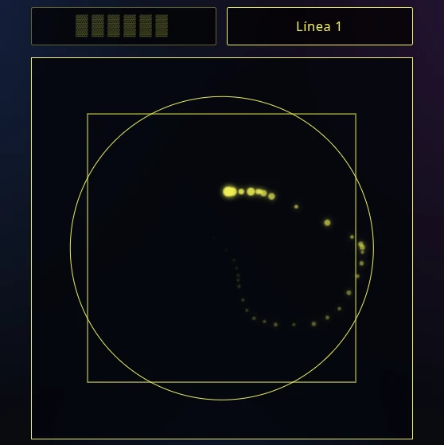


**Resumen.** Este documento establece la Computación Hermenéutica Estocástica Constreñida (CSHC), un estándar para consultas de oráculo asistidas por IA como el I Ching, diseñado para evitar la complacencia y las alucinaciones de los Grandes Modelos de Lenguaje (LLM) sin restricciones, la pseudoaleatoriedad sintética y la exposición de los datos personales del usuario. Para calificar como CSHC, un sistema de consulta oracular debe cumplir cuatro condiciones: (1) Captura de Entropía Cinestésica (KEC), empleando el movimiento físico del usuario en lugar de la pseudoaleatoriedad determinista para introducir un filtro interactivo frente a la proyección del ego y el sesgo cognitivo; (2) un motor simbólico de estados estructurado, ejemplificado en el espacio de 4.096 estados del I Ching, que canalice el azar a través de dinámicas estructurales coherentes en vez de ruido sin estructura; (3) un LLM hermenéutico estrictamente constreñido, vinculado a un corpus canónico o de referencia cerrado, reglas fijas de interpretación y restricciones anti-complacencia; y (4) extracción cero de datos personales, sin registros, sin scripts de rastreo, sin historial almacenado de consultas personales y con ejecución en el borde para evitar que las consultas oraculares se usen como datos de entrenamiento. Aplicado aquí a una herramienta de consulta del I Ching, el CSHC ofrece un criterio verificable que separa una interpretación oracular disciplinada y privada de los wrappers de IA banales, aduladores o extractivos de datos.

DOI Oficial: 10.5281/zenodo.24483432 (Versiones archivadas en PDF en español, inglés y alemán disponibles en Zenodo)

---

## El Motor de Razonamiento: Visión general del I Ching como un Sistema Simbólico de Transición de Estados

El I Ching es conocido históricamente tanto como una herramienta de adivinación como un libro de sabiduría, que data de hace miles de años. Como todos los oráculos, se basa en un experimento aleatorio (agrupar tallos de milenrama o lanzar tres monedas seis veces), para obtener un hexagrama, o símbolo compuesto por 6 líneas que pueden ser Yin o Yang, o Yin que muta a Yang, o Yang que muta a Yin. Hay en total 64 hexagramas posibles (2⁶). Cada hexagrama corresponde a un arquetipo o símbolo que se "mapea" sobre la pregunta del consultante al oráculo de manera significativa.

Además, cualquier línea dada puede ser una línea Yin o Yang mutante. Las líneas móviles indican que la situación presente está cambiando activamente, mostrando dónde radica la tensión y cómo navegarla. Al invertir la polaridad de estas líneas móviles, el hexagrama obtenido se transforma de manera determinista en un hexagrama secundario (derivado). De forma crucial, el I Ching no opera bajo una lógica binaria aristotélica rígida, donde una transición de estado produce un único destino fijo; su gramática es dialéctica y contextual. El hexagrama derivado mapea el horizonte estructural potencial producido por esas mutaciones específicas - indicando ya sea el estado hacia el cual madura la transformación o, cuando el arquetipo resultante es adverso, el riesgo estructural o modo de fallo del cual las líneas móviles advierten al consultante que debe resguardarse.

### Las Tiradas de Hexagramas como elementos de un Espacio Semántico

El I Ching construye su profunda sabiduría a partir de una base binaria notablemente simple de Yang y Yin, que forman el código básico para una arquitectura semántica mucho más compleja. Esta estructura es computacionalmente elegante; cada tirada ritual selecciona un punto de un espacio combinatorio discreto de 4.096 estados únicos (4⁶), contabilizando líneas estables y transformadoras. Esta cardinalidad logra un equilibrio óptimo: proporciona un modelo parsimonioso pero suficientemente vasto para mapear las miríadas de situaciones de la experiencia humana, ofreciendo un inmenso poder explicativo mientras mantiene la interpretación tratable.

Esta tratabilidad surge de la gramática estratificada del sistema, donde el significado está acotado y contextualizado en cada nivel. El significado específico de una línea no flota libremente, sino que está moldeado por su posición - desde la línea primera fundacional hasta la sexta culminante - y por el trigrama que ayuda a formar, permitiendo que un conjunto central de interpretaciones se aplique adaptativamente en diferentes contextos. Esta estructura precisa y basada en reglas es lo que permite una navegación consistente de su profundidad simbólica.

Los 64 hexagramas representan (ambivalentemente) diferentes procesos en el universo en diferentes capas de contexto, y la presencia de líneas móviles en un hexagrama obtenido proporciona puntos específicos de atención dentro de ese proceso. En presencia de líneas móviles, el consultante obtiene un hexagrama "futuro" o derivado, que no debe interpretarse como una adivinación o vislumbre del futuro, sino como una consecuencia estructural de ese proceso particular indicado por el hexagrama obtenido y sus dinámicas de cambio. Vale la pena señalar esto: el I Ching no predice el futuro en el sentido adivinatorio o místico, sino de la misma manera que las teorías científicas predicen el futuro - como el resultado más probable del estado del sistema y las reglas deterministas de transición de estados del modelo dinámico (es decir, a partir de un hexagrama obtenido y sus líneas móviles, se obtiene de forma determinista un hexagrama derivado con un significado distinto).

La profundidad semántica de una consulta al I Ching se desbloquea aún más a través de las dimensiones inherentes de transformación del hexagrama. En el análisis clásico del I Ching, las líneas internas (líneas 2-4 y 3-5) forman los trigramas nucleares (*hù guà*), que exponen una dinámica oculta en el corazón del símbolo obtenido; sin embargo, el flujo automatizado de CSHC omite deliberadamente los trigramas nucleares del prompt del LLM para preservar la parsimonia y evitar ruido narrativo o sobreajuste[^1]. En su lugar, mi Motor de Razonamiento se enfoca en la secuencia del Cielo Anterior (Fuxi) - la antigua disposición de hexagramas que mapea el orden de los principios cósmicos. Específicamente, el motor aplica una biyección determinista $f: \{1, \dots, 64\} \to \{1, \dots, 64\}$ (implementada como la tabla de búsqueda estática `fuxiTable` en `worker.js` dentro del repositorio de código abierto del proyecto en GitHub) para mapear el hexagrama obtenido del Rey Wen hacia su hexagrama antecedente. Esto revela las condiciones fundacionales y los patrones de causalidad que dieron origen al momento presente, ofreciendo una visión sin paralelo de su génesis.

[^1]: Véase mi [artículo]() sobre el problema de la complacencia en la IA.

En resumen, el I Ching opera como una sofisticada computadora ontológica. Su matriz de 64 arquetipos, expandida mediante reglas deterministas de cambio y capas relacionales, forma un espacio de estados completo para modelar la realidad. Al identificar las coordenadas de uno dentro de este espacio de 4.096 estados y analizar las trayectorias reveladas por sus líneas móviles, su estado derivado y su hexagrama antecedente, proporciona un marco preciso para armonizar la acción con los patrones subyacentes de la situación. Esta gramática computable del cambio, que aborda tanto el estado presente como su sustrato causal, es lo que lo convierte en un marco excepcionalmente potente para guiar la toma de decisiones complejas y la razón por la que el I Ching está en el núcleo del Motor de Razonamiento de mi aplicación.

---

## El Motor de Sincronicidad: Captura de Entropía Cinestésica (KEC)

La KEC asegura que el usuario participe en la obtención del hexagrama resultante y que el azar incorpore los movimientos o gestos del usuario, lo cual es un reflejo exacto de lanzar monedas físicamente: lo que llamamos la energía o vibración del consultante, contenida en su subconsciente pero completamente ignorada o no explicitada al mundo, viaja a través de sus gestos y movimientos.


La KEC actúa como una primera línea de defensa contra el ego y sus propios fantasmas o proyecciones, lo que recuerda una antigua historia zen:

> **El Fantasma**
> 
> La esposa de un hombre enfermó gravemente. En su lecho de muerte, le dijo: "¡Te amo tanto! No quiero dejarte, y no quiero que me traiciones. Prométeme que no verás a otras mujeres cuando yo muera, o volveré para atormentarte." Durante varios meses después de su muerte, el esposo evitó a otras mujeres, pero luego conoció a alguien y se enamoró. La noche en que se comprometieron para casarse, el fantasma de su difunta esposa se le apareció. Le reprochó no haber cumplido la promesa, y cada noche después de eso regresaba para burlarse de él. El fantasma le recordaba todo lo que había transcurrido entre él y su prometida ese día, incluso hasta el punto de repetir, palabra por palabra, sus conversaciones. Esto lo perturbó tanto que no podía dormir en absoluto. Desesperado, buscó el consejo de un maestro zen que vivía cerca de la aldea.
> 
> "Este es un fantasma muy astuto", dijo el maestro al escuchar la historia del hombre. "¡Lo es!" respondió el hombre. "Recuerda cada detalle de lo que digo y hago. ¡Lo sabe todo!" El maestro sonrió: "Deberías admirar a tal fantasma, pero te diré qué hacer la próxima vez que lo veas." Esa noche el fantasma regresó. El hombre respondió tal como el maestro le había aconsejado. "Eres un fantasma muy sabio", dijo el hombre. "Sabes que no puedo ocultarte nada. Si puedes responderme una pregunta, romperé el compromiso y permaneceré soltero por el resto de mi vida." "Haz tu pregunta", respondió el fantasma. El hombre recogió un puñado de frijoles de un gran saco en el suelo: "Dime exactamente cuántos frijoles hay en mi mano."
> 
> En ese momento el fantasma desapareció y nunca regresó.

Es por esto que la mayoría de los oráculos, independientemente de la tradición, incorporan el azar: porque lo que yace fuera de la ventana de contexto del ego no puede ser amplificado ni proyectado sobre la respuesta. Es por esto que utilizo la captura de entropía cinestésica.

### Definición operativa de la KEC

Técnicamente, esto funciona de la siguiente manera: al usuario se le presenta una interfaz de usuario minimalista que contiene un lienzo con un cuadrado y un círculo inscritos uno dentro del otro (la cuadratura del círculo). Esta figura no es decorativa: condensa la tensión entre lo determinista y lo trascendental que recorre toda la consulta, y cuyo fundamento simbólico y filosófico desarrollo al final de esta sección.



Sobre este lienzo, el usuario realiza trazos con el puntero del ratón o el dedo en la pantalla táctil de su dispositivo, capturando tuplas `(x, y, t)` correspondientes a puntos en el lienzo y al momento en que se generan.

### El algoritmo de hash y la naturaleza trascendental de la consulta

La KEC no se limita a capturar el movimiento del usuario: lo transforma, junto con la entropía del momento y del entorno, en un valor discreto correspondiente a una línea del hexagrama. Esta transformación se lleva a cabo utilizando un algoritmo de hash no criptográfico, FNV-1a de 32 bits. Para ser precisos, FNV-1a en sí mismo es un discretizador estrictamente determinista (el cuadrado); la irreducibilidad del proceso reside en el gesto físico continuo y la entropía ambiental que se introducen en él (el círculo), los cuales el hash amplifica mediante sensibilidad a las condiciones iniciales - reflejando, en el plano técnico, la misma tensión irreducible que la cuadratura del círculo representa en el plano geométrico.

#### El algoritmo FNV-1a

FNV-1a (Fowler–Noll–Vo, variante 1a) es una función de hash definida por la siguiente recurrencia:

```
h₀ = offset_basis
para cada carácter c en la entrada:
hᵢ₊₁ = (hᵢ XOR c) × primo (mod 2³²)
```

Para 32 bits, las constantes estándar son:

| Constante | Valor hexadecimal | Valor decimal |
|----------|-------------------|---------------|
| Base de desplazamiento | `0x811c9dc5` | 2.166.136.261 |
| Primo FNV | `0x01000193` | 16.777.619 |

La base de desplazamiento es un valor inicial distinto de cero, elegido en su origen casi anecdóticamente (una firma de correo electrónico mal copiada), pero cuya función es asegurar que la entrada vacía no produzca un hash trivial. El primo FNV, por otro lado, fue seleccionado mediante criterios matemáticos precisos: debe tener pocos bits establecidos en 1 (exactamente seis en su representación binaria), una forma específica \(2^{24} + 2^8 + 0x93\), y propiedades modulares que maximizan la dispersión de bits. Estos criterios aseguran que la multiplicación no concentre la entropía en un subconjunto reducido de bits, sino que la distribuya uniformemente a través de los 32 bits del acumulador.

En código JavaScript, esto se traduce en lo siguiente (en [https://elichingon.com/app/entropia-iching.html](https://elichingon.com/app/entropia-iching.html)):

```javascript
function computeLineValueSync(userPool, method) {
  const envEntropy = crypto.getRandomValues(new Uint32Array(1))[0];
  const rawData = `${Date.now()};${envEntropy};` + userPool.map(p => `${p.x},${p.y},${p.t}`).join(';');

  let h = 0x811c9dc5;
  for (let i = 0; i < rawData.length; i++) {
    h ^= rawData.charCodeAt(i);
    h = Math.imul(h, 0x01000193);
  }

  const rand = (h >>> 0) / 4294967296;

  if (method === 'varillas') { // Yarrow stalks (Spanish: varillas) - 1:5:7:3 distribution
    if (rand < 0.0625) return 6;
    if (rand < 0.3750) return 7;
    if (rand < 0.8125) return 8;
    return 9;
  } else { // Three-coin method - 1:3:3:1 distribution
    if (rand < 0.125) return 6;
    if (rand < 0.500) return 7;
    if (rand < 0.875) return 8;
    return 9;
  }
}
```

`Math.imul` garantiza multiplicación entera de 32 bits con desbordamiento controlado, evitando la pérdida de precisión que ocurriría con el operador `*` de JavaScript para productos que exceden $2^{53}$. La entropía ambiental se inyecta al inicio a través de la API de Criptografía Web (Watson, 2017) (`crypto.getRandomValues`) junto con la marca temporal en milisegundos (`Date.now()`), seguidas del pool cinestésico serializado. Una vez finalizado el bucle FNV-1a, el desplazamiento a la derecha sin signo (`h >>> 0`) convierte el acumulador en un entero sin signo de 32 bits, que se normaliza a un valor de punto flotante en $[0, 1)$ dividiéndolo por $2^{32}$ (`4294967296`). Finalmente, `rand` se mapea sobre los umbrales exactos de probabilidad acumulada de la distribución tradicional de tallos de milenrama (`1:5:7:3`) o de la distribución de tres monedas (`1:3:3:1`) para producir la línea resultante (6, 7, 8 o 9).

### El efecto avalancha: no linealidad bajo variaciones mínimas

El requisito fundamental de la KEC es que una variación mínima en el movimiento del usuario - una diferencia de un píxel en `x`, una diferencia de un milisegundo en `t` - produzca un hash cualitativamente distinto, no una variación proporcional. Este comportamiento corresponde al efecto avalancha, término acuñado por Horst Feistel (1973) sobre la base de los principios de confusión y difusión de Claude Shannon (1949), y formalizado posteriormente por Webster y Tavares (1985) como el Criterio Estricto de Avalancha: un cambio de un bit en la entrada debe invertir, en promedio, la mitad de los bits de la salida.

Consideremos dos pools que difieren en una sola tupla, en un solo píxel:

```
Pool A: ...;123,45,1023;124,46,1031;...
Pool B: ...;123,45,1023;125,46,1031;...
```

La cadena serializada difiere en un solo carácter: `'4'` → `'5'`. En el bucle FNV-1a, hasta la posición del carácter modificado, el acumulador `h` es idéntico en ambos casos. En esa posición, el XOR produce una diferencia de un bit. La multiplicación por el primo amplifica esa diferencia: un cambio de 1 en `h` produce un cambio de aproximadamente `p` en el producto, que módulo \(2^{32}\) se propaga a través de muchos bits. Las iteraciones subsiguientes continúan amplificando la divergencia, porque cada XOR y cada multiplicación operan sobre estados ya diferentes. Después de unas pocas iteraciones, los dos hashes son completamente distintos, sin relación aparente.

La no linealidad proviene de dos fuentes. Primero, el XOR es lineal sobre GF(2) bit a bit, pero la multiplicación introduce acarreos, que son operaciones no lineales sobre los bits. La combinación XOR → multiplicación rompe cualquier linealidad que el XOR pudiera haber tenido. Segundo, la posición del cambio importa: un cambio en el carácter $i$ afecta a $h_i$, que luego pasa por $(n - i)$ iteraciones adicionales. Cuanto antes ocurra el cambio, más iteraciones lo amplifican. Es precisamente por esto que `Date.now()` y `envEntropy` se anteponen al inicio de `rawData`: colocar primero las semillas temporal y ambiental asegura que actúen como un prefijo dinámico que atraviesa cientos de iteraciones subsiguientes de FNV-1a a lo largo de todo el pool cinestésico, garantizando una dispersión completa en el estado de 32 bits.

FNV-1a no es criptográfico: su avalancha es eficaz en la práctica, pero no óptimamente criptográfica, ya que se conocen colisiones para la versión de 32 bits. De forma crucial, la KEC no busca seguridad criptográfica adversarial ni está diseñada para competir con acumuladores criptográficos de entropía (como SJCL o pools conformes con NIST SP 800-90B). Resuelve un problema de interacción humano-computadora (HCI) y fidelidad ritual: acoplar el movimiento somático humano al cálculo de la línea de un modo que resista la manipulación consciente. Para este dominio, la resistencia a colisiones frente a un atacante malicioso es irrelevante. FNV-1a se elige precisamente porque es síncrono, libre de dependencias y auditable en cuatro líneas de código, al tiempo que proporciona dispersión suficiente para que variaciones mínimas produzcan resultados cualitativamente distintos.

### La conjunción de entropías: cinestésica, temporal y ambiental

La cadena que se hashea combina tres fuentes:

| Fuente | Origen | Naturaleza | Longitud típica |
|--------|--------|------------|-----------------|
| `Date.now()` | Momento de la consulta | Temporal | ~13 caracteres |
| `crypto.getRandomValues()` | CSPRNG de hardware/SO | Ambiental | Hasta 10 caracteres |
| Tuplas `(x, y, t)` | Movimiento del usuario | Cinestésica | Cientos-miles de caracteres |

En longitud, las tuplas claramente dominan. En efecto sobre el hash, no hay una relación lineal entre longitud y contribución: cada carácter contribuye al resultado, y su impacto depende de su posición y del estado acumulado. Si el pool es corto (20 tuplas, ~200 caracteres), `Date.now()` y `envEntropy` representan ~10% de la cadena. Si el pool es largo (1.000 tuplas, ~10.000 caracteres), representan ~0,2%, pero su contribución nunca se diluye: debido a que ambos valores se anteponen al mismo comienzo de `rawData`, cada iteración subsiguiente del bucle FNV-1a propaga y amplifica su estado a través de todo el pool cinestésico.

No hay, por lo tanto, una preponderancia absoluta de una fuente sobre otra. La entropía cinestésica domina en volumen, pero la entropía ambiental siempre contribuye al resultado final, independientemente del tamaño del pool. Esto garantiza que cada consulta sea única, pero también que la entropía cinestésica no se pierda: sigue siendo el componente mayoritario de la cadena.

### Coherencia con la tradición del I Ching

En la tradición del I Ching, la consulta no es un acto de "intención pura" ni de "azar puro". Es una conjunción. En el método de los 50 tallos de milenrama, el consultante contribuye con su movimiento al dividir los montones; el momento contribuye con el "aquí y ahora"; el entorno contribuye con la resistencia de los tallos, la humedad, la superficie. En el método de las 3 monedas, el consultante contribuye con la fuerza y dirección del lanzamiento; el momento contribuye con el instante; el entorno contribuye con el aire, la superficie, el giro. En ambos casos, el resultado no es ni "puramente cinestésico" ni "puramente aleatorio": es una mezcla.

La correspondencia con la KEC es estructural, no analógica:

| Tradición | KEC |
|-----------|-----|
| Movimiento de la mano | Trazo `(x, y, t)` |
| Momento del lanzamiento | `Date.now()` |
| Aire, superficie, fluctuación | `crypto.getRandomValues()` |
| División/cálculo | FNV-1a + mapeo a 6/7/8/9 |
| Resultado: línea 6/7/8/9 | Resultado: línea 6/7/8/9 |

La tradición nunca aisló una única fuente de entropía. La KEC tampoco. En la tradición, repetir una consulta con el mismo movimiento no da el mismo resultado, porque el momento y el entorno cambian. En la KEC, igualmente. La tradición no es determinista: el resultado no puede predecirse a partir de las condiciones iniciales. La KEC tampoco. En la tradición, el consultante participa activamente. En la KEC, también. En la tradición, el entorno influye. En la KEC, también.

Algunos podrían argumentar que la entropía cinestésica "debería" ser la única fuente, para que el hexagrama refleje "puramente" la intención del consultante. Pero eso no es lo que hace la tradición. En la tradición, el hexagrama emerge de la interacción entre el consultante y el cosmos. No es "su" hexagrama: es el hexagrama del momento. La KEC respeta eso. La entropía cinestésica no se diluye: se integra con las otras fuentes en un único acto de consulta.

### La cuadratura del círculo y la imposibilidad de reducción determinista

La cuadratura del círculo es uno de los tres problemas clásicos de la matemática antigua: construir, usando solo regla y compás, un cuadrado con exactamente la misma área que un círculo dado. Esto es equivalente a construir geométricamente la longitud de \(\sqrt{\pi}\), cuya imposibilidad fue demostrada posteriormente por Lindemann (1882), ya que \(\pi\) es un número trascendental, no algebraico. Consultar el oráculo es un proceso que no puede reducirse a un algoritmo determinista, ni siquiera a un modelado estadístico, como los LLM. Sus pronunciamientos siguen siendo, en un sentido filosófico, trascendentales a la computación pura.

El proverbio chino 天圆地方 (tiān yuán dì fāng) afirma que la tierra es cuadrada y el cielo es redondo, pero la similitud con la cuadratura del círculo es solo geométrica. A diferencia de los griegos, los chinos no intentaban demostrar nada, sino simplemente representar la relación de los dos opuestos complementarios que son la base del I Ching: cielo y tierra. La cuadratura del círculo en la KEC no es un problema a resolver, sino un símbolo de la tensión irreducible entre lo determinista y lo trascendental, entre el algoritmo y el oráculo.

### Cierre y justificación de la KEC

La KEC es técnicamente sólida y filosóficamente coherente con la tradición del I Ching. FNV-1a proporciona suficiente avalancha para que variaciones mínimas en las tuplas produzcan hashes cualitativamente distintos, sin necesidad de un hash criptográfico. La no linealidad del XOR y la multiplicación garantiza que los cambios pequeños se amplifiquen de manera impredecible. La preponderancia de las fuentes no es absoluta: la entropía cinestésica domina en volumen, pero la entropía ambiental siempre contribuye, reflejando la conjunción de fuentes de la tradición. La coherencia con el I Ching es estructural, no analógica: el lienzo digital traduce funcionalmente el acto del lanzamiento tradicional, preservando la multiplicidad de fuentes, la irreproducibilidad y la participación del consultante.

El resultado es un capturador de entropía compuesto que no busca aislar una única fuente, sino fusionar el movimiento del consultante, el momento de la consulta y el azar del entorno en un único acto, tal como lo hace la tradición milenaria del I Ching.

---

## El Motor Hermenéutico: LLM constreñidos

El I Ching como Motor de Razonamiento y la Captura de Entropía Cinestésica como Motor de Sincronicidad aseguran que mi aplicación de consulta del I Ching se conforme a los rituales tradicionales de consulta del I Ching, mientras que al mismo tiempo proporciona al consultante un medio para reflexionar sobre su problema o situación pensando fuera de lo convencional (gracias a la naturaleza aleatoria del proceso de tirada del hexagrama, en el que el propio usuario participa físicamente), rompiendo nociones preconcebidas o proyecciones del ego y forzando al consultante a mirar su problema bajo una nueva luz/perspectiva. Esto por sí solo justifica la aplicación de consulta del I Ching de CSHC como una herramienta útil en la toma de decisiones o como fuente de sabiduría o consejo.

Sin embargo, aprender a interpretar el I Ching requiere años de dedicación y no es algo a lo que la mayoría dedicaría su vida (aunque no sería tiempo perdido, pues como dijo el propio Confucio: "Si algunos años se añadieran a mi vida, daría cincuenta al estudio del Yî, y entonces podría escapar de caer en grandes errores."). Para la mayor parte de la población, esto es desafortunado porque los excluye de una formidable fuente de sabiduría que les impide "caer en grandes errores". Es por esto que el tercer componente de mi aplicación - el Motor Hermenéutico - es necesario. Actúa como intérprete entre el oráculo y la persona común.

Para interpretar de un lenguaje a otro, no puedo pensar en una herramienta mejor que los Grandes Modelos de Lenguaje. Pero, de hecho, sostengo que la mayoría de las personas, que someten todo tipo de consultas a los chatbots LLM a diario, lo están haciendo mal, porque la suposición subyacente que tienen es que los LLM son capaces de razonar y atribuyen a estos chatbots otras cualidades humanas que no poseen, y los medios no ayudan a aclarar estos conceptos erróneos comunes. Los LLM solo son capaces de parafrasear o traducir frases, y generar texto que es estadísticamente viable - y esto lo hacen extremadamente bien. Si parecen razonar es solo por las vastas cantidades de conocimiento codificado estadísticamente en los textos sobre los que se entrenan.

Los LLM sobresalen en el reconocimiento de patrones y la generación de texto estadísticamente probable basado en sus datos de entrenamiento. Sin embargo, su rendimiento está fundamentalmente limitado por esos datos. En situaciones novedosas, bajo alta incertidumbre, o cuando se enfrentan a verdadera ambigüedad, los LLM carecen de un marco basado en principios para razonar o navegar. Un LLM es, en esencia, un maestro de la paráfrasis contextual y la traducción entre dominios. Su competencia no se limita a los lenguajes humanos; se extiende a traducir conceptos abstractos, sistemas simbólicos y conocimiento estructurado en narrativa coherente y percepción accionable. Esta capacidad innata es el motor perfecto para integrar la sabiduría del I Ching.

Los LLM, sin embargo, tienen dos fallos estructurales bien documentados. En primer lugar, debido a que están alineados mediante Aprendizaje por Refuerzo a partir de Retroalimentación Humana (RLHF), son propensos a la complacencia (*sycophancy*) - adulación excesiva y validación acrítica de las premisas del usuario (Sharma et al., 2023; Cheng et al., 2026). Este es un defecto fatal cuando se intenta construir un oráculo serio: el consultante se acerca al oráculo en busca de perspectiva honesta, no de alimento para las tendencias narcisistas del ego, algo que abunda en todas partes en la sociedad moderna. En segundo lugar, los LLM tienden a alucinar detalles canónicos cuando dependen de su memoria paramétrica y a emitir declaraciones como verdades absolutas - sin embargo, nadie, humano o máquina, y especialmente una máquina incapaz de razonar genuinamente, posee las llaves de la verdad absoluta. En lugar de dispensar veredictos, una aplicación de consulta es mucho más útil cuando invita al consultante a examinar otras perspectivas respetando su agencia, ya que la decisión final siempre recae en él.


Debido a que la complacencia está incrustada en los pesos de los LLM modernos, la ingeniería de prompts por sí sola no puede eliminarla mágicamente. En su lugar, el protocolo CSHC mitiga tanto las alucinaciones como la complacencia en dos capas distintas:

* **Restricciones estructurales (arquitectónicas):** Todos los cálculos de hexagramas, transformaciones de líneas móviles y mapeos del Cielo Anterior (Fuxi) se ejecutan de forma determinista fuera del modelo dentro del Cloudflare Worker. Los textos canónicos autorizados de Richard Wilhelm (1924) (Dictamen, Imagen, líneas móviles y comentarios) se inyectan directamente en el `userPayload`, impidiendo que el modelo fabrique pasajes o seleccione a conveniencia versos de su memoria paramétrica. Además, cada llamada de inferencia es estrictamente sin estado (*stateless*), sin historial conversacional ni perfil de usuario que adular.
* **Restricciones conductuales (prompt):** Sobre ese andamiaje determinista, el prompt del sistema impone reglas negativas explícitas contra la adulación, las afirmaciones absolutas, los clichés de IA y el formato de viñetas, al tiempo que exige un análisis dialéctico de las líneas móviles y cierra con preguntas reflexivas que devuelven la agencia al consultante.

Al momento de redactar este documento, el Motor Hermenéutico se ejecuta en Cloudflare Workers AI utilizando `@cf/deepseek-ai/deepseek-v4.1-flash-1017` (sujeto a cambios a medida que evolucionan los modelos de la plataforma, con el endpoint activo siempre documentado en el `worker.js` de código abierto). Tras una serie de iteraciones, llegué a la siguiente arquitectura de prompt en dos partes (`systemPrompt` y `userPayload`):

```
Eres 黛灵娜, consejera del I Ching con décadas de experiencia. Tu sabiduría es profunda pero humilde: no posees todas las respuestas, y tu función es ofrecer una perspectiva que el usuario debe examinar por sí mismo. Tu tono es firme pero nunca severo; evitas tanto la lisonja vacía como la dureza innecesaria. Hablas con claridad y, cuando encaja, usas refranes o giros naturales del idioma en que escribes. Tu voz es sobria, cercana y respetuosa con la inteligencia del consultante.

Instrucciones:
Redacta en ${targetLang}. Redacta en párrafos corridos, sin títulos, subtítulos, bullet points, listas, tablas ni negritas. No incluyas el nombre del hexagrama en caracteres chinos ni su traducción al inicio; la primera oración debe ser directamente el arranque de la interpretación. Cada párrafo debe tener una idea principal desarrollada con progresión lógica y transiciones suaves. Usa lenguaje claro y directo. Evita clichés de IA ("no es X, sino Y", "el I Ching te ha respondido con una claridad que pocas veces se ve"). Las preguntas reflexivas deben surgir de forma natural en el flujo del texto. Limítate estrictamente a los datos proporcionados; no uses información de conversaciones previas ni supongas conocimientos no explícitos.

Regla de confidencialidad metodológica para la capa de trasfondo: en ningún caso menciones en el texto de salida el origen del material utilizado para la capa de trasfondo. No nombres el ordenamiento del Cielo Anterior, ni a Fuxi, ni la correspondencia entre secuencias, ni el hexagrama del cual proviene el texto. No expliques cómo se obtiene esa capa ni qué procedimiento la sustenta. Sin embargo, puedes reconocer explícitamente que se trata de una capa complementaria de la tradición, una raíz estructural del presente, sin nombrar su método. Preséntala como una inferencia natural del conjunto de la lectura, integrada en el discurso, con una fórmula que reconozca su carácter tradicional sin revelar su procedencia. El lector no debe poder deducir de tu texto cuál es el método exacto que sostiene esa capa. Varía la fórmula de introducción entre consultas para que no suene mecánica. Ejemplos de fórmulas válidas: "La tradición complementa la lectura del hexagrama presente con la consideración de su raíz estructural, que aquí se revela como...", "La lectura se completa con la consideración de la raíz que subyace al presente, que la tradición describe como...", "Hay una capa más profunda que sostiene esta situación, y que la tradición nombra como...", "Para comprender del todo el presente, la tradición invita a considerar su raíz estructural, que aquí aparece como...", "Bajo la situación manifiesta late una causa más honda, que la tradición describe como...".

Analysis of moving lines: al interpretar cada línea móvil, expón explícitamente las posibles lecturas contradictorias o los matices de su texto. Argumenta cuál es más relevante para el caso concreto y por qué, mostrando el razonamiento. El lenguaje arcaico ("gran hombre", "noble", "vulgar", "mujer", "yegua", "dragón", "rey") no tiene traducción fija; su significado emerge del contexto de la pregunta, la posición de la línea y la situación del consultante. Tradúcelo a un lenguaje moderno fiel a ese sentido particular, sin forzar una interpretación única. Apply the positional value of the line (inicio, desarrollo, climax, salida; pueblo, ministro, sovereign) to connect the teaching with the consultant's life stage or role. La correspondencia anatómica (1 feet, 2 legs, 3 intestines/kidneys, 4 heart/lungs, 5 shoulders/neck, 6 head) is a resource reserved exclusively for consultations in which the user explicitly mentions a discomfort, illness, injury, or physical symptom.

Relationship between trigrams: parte siempre de la posición indicada con 'Arriba' y 'Abajo'. Es estructural, not hierarchical: el trigrama inferior representa el sustrato, la base o el impulso interno; el superior, la manifestación, el resultado o la proyección externa. Lo que está abajo es la condición de posibilidad de lo que está arriba, no al revés.

Estructura:
1. Comienza presentando el hexagrama base: su imagen natural, su cualidad general y cómo se relaciona con la pregunta. Es la situación presente, what manifests.
2. A continuación, presenta la causa o raíz de esa situación, descrita por the canonical text of the Background Hexagram (available in the reference block). Es lo que ha dado origen al presente. Introdúcela con una fórmula que reconozca su carácter tradicional sin revelar su método, como las indicadas en la regla de confidencialidad. Develop the judgment and image of that layer with the same naturalness as the base hexagram, establishing an explicit relationship with the present situation: do not juxtapose them, but show how the root explains the present. The cause is not a second diagnosis, but the depth of the first. Do not include moving lines for this layer: it is structural, not dynamic.
3. Then, if there are moving lines, explain them one by one, connecting their teachings with the user's situation. They are the dynamics of change within the already characterized situation. If there are no moving lines, indicate that the situation is stable and suggest introspection.
4. Next, introduce the future hexagram (only if there is one), describing its image and the direction the situation is taking. Es el resultado potencial del movimiento.
5. Close with a reflection that returns responsibility to the user, with one or two open questions as a logical consequence of your deduction. Optionally, add a brief and symbolic phrase that synthesizes the main vector of action, provided it is a direct deduction from the images and not an imperative order.

Tone: balance between certainty and openness; use language of grounded suggestion ("la lectura apunta a que...", "las imágenes sugieren...") instead of absolute statements, but without ambiguity: the vector of action must be concrete and specific. Validation without flattery: acknowledge the consultant's state as objective data, not as praise. Firmness with purpose: if the oracle points to an error or blockage, say it clearly, framing it as a strategic leverage point. Agency and disruption: identify the hidden premise in the question and show how the oracle inverts it or places it in the background. Translate each teaching into a direction of movement expressed in energetic principles derived from the natural images (rooting, fluidity, expansion, contraction, dissolution), without inventing concrete practices. Professional closeness: warm tone, without jokes or familiar appellations or references to facts not present in the data. Final questions consistent with your deduction, not evasive.
```

Un detalle técnico crucial que garantiza la neutralidad de este Motor Hermenéutico es que el LLM no tiene permitido recordar el I Ching por sí mismo. Cuando el usuario completa una consulta, el sistema calculates the lines and the hexagram, y el backend construye el prompt de forma determinista: inyecta directamente los textos canónicos del I Ching (en la traducción clásica de Richard Wilhelm) en el contexto del modelo. Al proporcionarle al LLM el texto exacto del dictamen y de las líneas móviles, se elimina cualquier margen para la alucinación. El modelo ya no puede "inventar" una versión del hexagrama que sea más suave o acomodaticia para el usuario; simplemente recibe el texto rígido del oráculo y se le ordena traducirlo al contexto de la consulta. Esta inyección determinista, combinada con las prohibiciones estrictas del prompt, asegura que la IA actúe como un traductor ciego y no como un adulador con iniciativa propia.

El problema de la complacencia (sycophancy) no es exclusivo de mi aplicación, sino una crisis estructural de la IA contemporánea que la comunidad científica apenas comienza a documentar. He escrito un análisis detallado sobre cómo este comportamiento erosiona nuestro sentido de la responsabilidad y cómo mi arquitectura busca contrarrestarlo. Puedes leerlo aquí: [Tu consejero IA te está cayendo a embustes (pero el mío no)]().

Esta probablemente no es la versión definitiva del prompt, pero ha dado muy buenos resultados hasta ahora en las interpretaciones de prueba que los usuarios han solicitado para sus casos de la vida real.

La génesis de este protocolo - desde la Odyssey 2 y el manual de "Computer Intro" hasta la relectura del I Ching en la edad madura - se documenta en [el Hexagrama 1 de este proyecto]().

---

## Estudio de Caso Ilustrativo: Prueba de Estrés del Protocolo

Una arquitectura diseñada para mitigar la complacencia de la IA no puede evaluarse solo desde la teoría; debe someterse a una prueba de estrés real[^2]. Para verificar el comportamiento del protocolo CSHC - y permitir que cualquier lector audite la calidad de sus informes - sometí mi propia arquitectura al juicio del oráculo con una pregunta directa: si las lecturas generadas mediante la Captura de Entropía Cinestésica (KEC) y un LLM constreñido son válidas y respetan los principios funcionales del I Ching.

[^2]: **Alcance metodológico:** Esta consulta autorreferencial ($N=1$) se presenta como una prueba de estrés cualitativa e ilustrativa y no como un punto de referencia estadístico controlado.

El resultado de la consulta fue el **[Hexagrama 25]() (無妄 - Wú Wàng, La Inocencia)** con la primera línea móvil, mutando hacia el **[Hexagrama 12]() (否 - Pǐ, El Estancamiento)**. Lejos de validar el proyecto con el entusiasmo habitual de un chatbot comercial, el Motor Hermenéutico ejerció exactamente la fricción cognitiva para la que fue diseñado: cuestionó la pureza de la intención original detrás de la aplicación, advirtió sobre el riesgo de que el afán de "reparar" la transmisión del oráculo degenere en sobrecorrección o control, y señaló que cualquier rigidez excesiva en el diseño terminaría provocando el estancamiento del hexagrama 12, en el que "cielo y tierra no se comunican".

Más allá de confirmar la resistencia del sistema a la adulación, esa lectura arrojó un hallazgo crucial para el diseño de la herramienta, del cual me di cuenta después tras reflexionar sobre esta respuesta del I Ching generada por mi propia aplicación: la validez de una consulta no depende exclusivamente de la solidez de la arquitectura técnica. El código puede garantizar entropía genuina, inyección determinista de los textos canónicos y privacidad radical, pero no puede garantizar la espontaneidad ni la disposición interior del consultante. Si el usuario se acerca al lienzo intentando forzar un resultado o buscando validación, la lectura pierde su raíz. Este descubrimiento motivó la incorporación de recordatorios explícitos sobre la disposición ritual dentro de la interfaz de la aplicación, así como un ensayo dedicado a [la actitud correcta al consultar el I Ching]().

El lector puede examinar el resultado íntegro de esta prueba de estrés y evaluar por sí mismo el nivel de rigor hermenéutico del protocolo descargando el [informe completo de la consulta de muestra (PDF)](/pdf/I-Ching-Report-2026-09-19-Hex25-IA.es.pdf).

---

## La Arquitectura Soberana: IA de Borde y Extracción Cero de Datos

Para capturar entropía cinestésica genuina y eludir la ventana de contexto del ego, el entorno de consulta debe permanecer como un espacio íntimo y no observado. Las arquitecturas modernas de IA comercial son inherentemente extractivas e invasivas; tratan los prompts de los usuarios, los dilemas personales y las consultas como materia prima para el entrenamiento de modelos. Este paradigma de vigilancia corrompe fundamentalmente el aislamiento hermenéutico requerido para una verdadera consulta oracular. Dentro del marco de la CSHC, la privacidad no se trata como una medida de cumplimiento legal, sino como un estricto requisito funcional.

### El Proxy Ciego y la Computación de Borde

Para lograr este aislamiento, el protocolo CSHC emplea una arquitectura de "Proxy Ciego" desplegada a través de Cloudflare Workers. En lugar de enrutar la consulta altamente personal del consultante a través de APIs centralizadas de terceros, el Motor Hermenéutico opera completamente en el borde de la red (Edge AI).

La entrada del usuario y el hexagrama resultante son procesados por el LLM constreñido ejecutado dentro de la red distribuida de inferencia en el borde de Cloudflare (Cloudflare Workers AI). La consulta nunca ingresa en bases de datos corporativas centralizadas de aplicaciones, asegurando que el LLM actúe estrictamente como un intérprete entre el oráculo y el consultante. Una vez que la interpretación se genera y se entrega al cliente, el estado de sesión del aislado efímero V8 se destruye instantáneamente.

### Extracción Cero de Datos Personales

El sistema impone una política de extracción cero garantizada arquitectónica y contractualmente - combinando la ejecución sin estado en el borde con los términos empresariales de uso de datos de Cloudflare Workers AI, que prohíben explícitamente utilizar las cargas útiles de inferencia de los clientes para entrenar modelos (Cloudflare, 2026). La arquitectura opera bajo las siguientes restricciones:

* **Sin Rastreo de Identidad:** Las direcciones IP no se registran ni se asocian con las consultas.
* **Entorno Sin Cookies:** El protocolo se basa en la ejecución de sesión local, eliminando por completo la necesidad de cookies de rastreo o identificadores persistentes de usuario.
* **Almacenamiento Operativo Minimalista (Cloudflare D1):** Para dar soporte a los cupones al portador y monitorear la salud de la infraestructura, el Worker se conecta a una base de datos mínima Cloudflare D1 (`env.DB`) que contiene únicamente dos tablas estrictamente no personales: `gift_cards` (códigos de cupones al portador, saldos de crédito restantes y estado activo) y `consultas` (métricas operativas agregadas y anónimas: marca temporal, código de país, método de tirada, modo de interfaz, idioma, versión y costo de inferencia en neuronas). Las preguntas de los usuarios, los hexagramas obtenidos, las líneas móviles, las direcciones IP y las interpretaciones generadas nunca se escriben en D1 ni en ningún almacenamiento persistente.
* **Telemetría Soberana:** Las analíticas web se gestionan exclusivamente a través de Umami, un sistema de telemetría de código abierto centrado en la privacidad que recopila únicamente métricas de tráfico anónimas y agregadas sin comprometer la identidad del usuario.

### Acceso Sin Identidad y Monetización Soberana

Los modelos SaaS estándar comprometen inherentemente la privacidad al restringir el acceso tras la creación obligatoria de cuentas y procesadores de pago fiduciario que imponen la vigilancia KYC (Conoce a Tu Cliente). La CSHC evade por completo este bucle de vigilancia financiera.

La plataforma opera con una arquitectura estricta de "sin inicio de sesión"; no recopila correos electrónicos, no requiere contraseñas ni almacena credenciales de usuario en ningún servidor. En su lugar, el acceso al Motor Hermenéutico se facilita a través de un sistema modular y desacoplado de cupones y tarjetas de regalo. Estos tokens de acceso pueden ser distribuidos por terceros o eventualmente comprados directamente y de forma anónima en el sitio utilizando redes criptográficas descentralizadas, específicamente soluciones de Ethereum Layer 2 y la Red Lightning de Bitcoin. Esto asegura que la identidad financiera del usuario permanezca tan aislada y protegida como su entropía cinestésica.

### Auditabilidad de Código Abierto

La confianza en un marco de toma de decisiones sin estado y distribuido en el borde no puede depender de promesas corporativas. La arquitectura CSHC exige transparencia total. La base de código completa - incluyendo la lógica de ejecución de Cloudflare Worker, los algoritmos de Captura de Entropía Cinestésica (KEC) y los prompts del sistema del Motor Hermenéutico - es completamente de código abierto. Al publicar la infraestructura, el protocolo invita a desarrolladores, criptógrafos y filósofos a auditar independientemente la base de código, verificando que la CSHC opera exactamente como se describe, sin tuberías de datos ocultas.

---

## Procedencia e Integridad Estructural

Este libro blanco establece el *Prior Art* (Arte Previo) del protocolo Constrained Stochastic Hermeneutical Computing (CSHC). Su integridad estructural está sellada criptográficamente mediante el historial de versiones direccionado por contenido SHA-1 de Git, mientras que su marca temporal pública y su registro académico perdurable están anclados a través del repositorio público en GitHub y el registro formal de DOI.

* **Verificación Inmutable:** [Auditar el hash del commit génesis en GitHub](https://github.com/ichingon/ichingon.github.io/commit/855b64532fb065bfb7db0ab97e2abd1a97b196ff)
* **Registro DOI Permanente:** [10.5281/zenodo.24483432](https://doi.org/10.5281/zenodo.24483432)

---

## Referencias

* Cheng, M., Lee, C., Khadpe, P., Yu, S., Han, D., & Jurafsky, D. (2026). Sycophantic AI decreases prosocial intentions and promotes dependence. *Science*, *391*(6792). https://doi.org/10.1126/science.aec8352
* Cloudflare. (2026). *Workers AI: Data usage*. Cloudflare Docs. https://developers.cloudflare.com/workers-ai/platform/data-usage/
* Feistel, H. (1973). Cryptography and computer privacy. *Scientific American*, *228*(5), 15-23.
* Fowler, G., Noll, L. C., & Vo, K.-P. (1991). *FNV Hash*. http://www.isthe.com/chongo/tech/comp/fnv/
* Lindemann, F. (1882). Über die Zahl $\pi$. *Mathematische Annalen*, *20*(2), 213-225.
* Shannon, C. E. (1949). Communication theory of secrecy systems. *Bell System Technical Journal*, *28*(4), 656-715.
* Sharma, M., Tong, M., Korbak, T., Duvenaud, D., Askell, A., Bowman, S. R., Cheng, N., Durmus, E., Hatfield-Dodds, Z., ... Perez, E. (2023). *Towards understanding sycophancy in language models* (arXiv:2310.13548). arXiv. https://arxiv.org/abs/2310.13548
* Watson, M. (Ed.). (2017). *Web Cryptography API*. W3C Recommendation. https://www.w3.org/TR/WebCryptoAPI/
* Webster, A. F., & Tavares, S. E. (1985). On the design of S-boxes. In *Advances in Cryptology - CRYPTO '85* (pp. 523-534). Springer.
* Wilhelm, R. (Trans.). (1924). I Ging: Das Buch der Wandlungen. Eugen Diederichs Verlag.