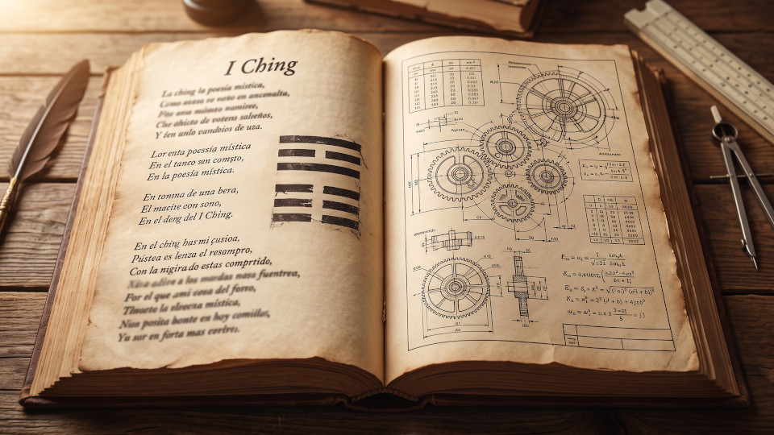

When people navigate to our [object finder application]() and encounter the term "Liu Yao", the first question is usually: *"But what exactly is this? Is it the I Ching or something else?"*

The quick answer is: **Yes, it uses the same foundation as the I Ching, but it is an entirely different system of interpretation.** 

To understand how this divination method differs from and resembles the classic I Ching, let's use an analogy from computer systems architecture. 

## 1. The Hardware and the Operating System

Imagine a "bare metal" computer. It has a microprocessor and circuits, but by itself, it does nothing. Its only function is to process electrical impulses to generate raw data. In our system, **this bare machine is the physical act of your reading**. 

Whether you throw three physical coins or use our kinesthetic entropy capture (making strokes on the screen with your finger), what you are doing is injecting a special kind of randomness, physically generated by you, which we call entropy, into the system to generate six numbers (6, 7, 8, or 9)[^1]. Those six numbers form the reading or the resulting and derived hexagram (if there are moving lines). This reading can be seen as the assembly language instruction code running on the "bare machine".

That's as far as the hardware goes. We have pure data extracted from chance. But for this to be understandable and useful to a human, we need to install an "Operating System" on that machine.

Historically, two major operating systems have been developed to process this data:

*   **The Classic I Ching:** This is the most famous system. It takes the hexagram and searches an ancient database (the text of King Wen, later expanded by Confucius and other scholars) to return a poem or metaphor. It is excellent for philosophy, for understanding the causes and dynamics of a complex life situation, but Hexagram 1 will always say the same thing, regardless of whether you consult on a Tuesday or a Sunday.[^2]
*   **The Liu Yao Method:** This is an operating system designed for engineering and pragmatic problem-solving. It discards the poems and, instead, runs the six lines through a mathematical calculation engine. But its biggest difference is that **it requires the system clock**. Liu Yao reads the exact date and time of your consultation and cross-references it with the lines of the hexagram, transforming them into a living data matrix that changes depending on when you ask.

**To put it in simple terms:**
Imagine that the reading you got from your kinesthetic entropy, the lines of the hexagram, are letters and paper (hardware and machine language). The classic I Ching gives us a poem or a philosophical essay from that. The Liu Yao method, on the other hand, gives us a table of technical specifications like the ones you find when you buy a home appliance, but also taking into account the temporal variable.

It's the same machine, but it generates two different texts.

## 2. What is Liu Yao used for?

While the classic I Ching responds well to open-ended questions like *"What attitude should I take toward this problem?"*, the Liu Yao method shines in binary, specific, and earthly scenarios. It works like a diagnostic scanner for real life.

Because it cross-references the hexagram with time (the month and day of the consultation), the system assigns each of the six lines a "role" and an energy state. This allows us to apply it to multiple scenarios:

*   **Finding Lost Objects:** The system searches for which of the six lines represents your object. By evaluating its state, it tells us if the line is "empty" (the object is hidden or covered) or if it is "strong" (the object is close and in plain sight)[^3]. 
*   **Automotive Mechanics Diagnosis:** Sometimes mechanics face "ghost failures" that the car's scanner doesn't detect. By mapping the vehicle onto the six lines, Liu Yao points out where the entropy (the failure) is and indicates whether it's a superficial problem (upper lines) or a hidden short circuit (lower lines, in an empty state).
*   **Health and Decision Making:** Whether evaluating an energy blockage in a body or the risk in a financial investment, the system measures the forces at play. It tells us if the "medicine" (the solution) has enough strength to overcome the "disease" (the problem), based on the season of the year in which the consultation is made.

Liu Yao is not magic; it is a probability map that evaluates where there is tension, where there is emptiness, and what forces are clashing within a closed system. (In upcoming articles in this series, we will explain in detail how these variables of force are calculated and read).

## 3. A bit of history: The origin of the method

All this mathematical architecture is not a modern invention of the computing era, but the product of one of the most brilliant minds of ancient China.

The Liu Yao method (which literally means "Six Lines") was developed during the **Western Han Dynasty (approx. 206 BC - 9 AD)** by a scholar and astronomer named **Jing Fang**. 

Jing Fang realized that the poetic text of the I Ching, while wise, was insufficient to accurately predict weather phenomena, agricultural cycles, and state problems. So, applying the astronomical logic of his time, he managed to couple the 64 hexagrams with the Chinese Sexagenary Calendar (the system of Heavenly Stems and Earthly Branches). Furthermore, he incorporated the theory of the five elements, or wuxing, to determine the relationship of forces in the system. We talk about Wuxing in another of my articles on the [I Ching and the Peking Opera]().

He was the one who invented the *Na Jia* system (the assignment of elements and animals to each line) and structured the 64 hexagrams into "Eight Palaces" or eight great families. In doing so, he transformed a book of wisdom into a sophisticated analytical inference engine that has survived and evolved for over 2,000 years, reaching our application today.

[^1]: See my [whitepaper]().
[^2]: See my [article on the I Ching as a universal language]().
[^3]: See my [article on how to use one of our apps to find lost objects]()