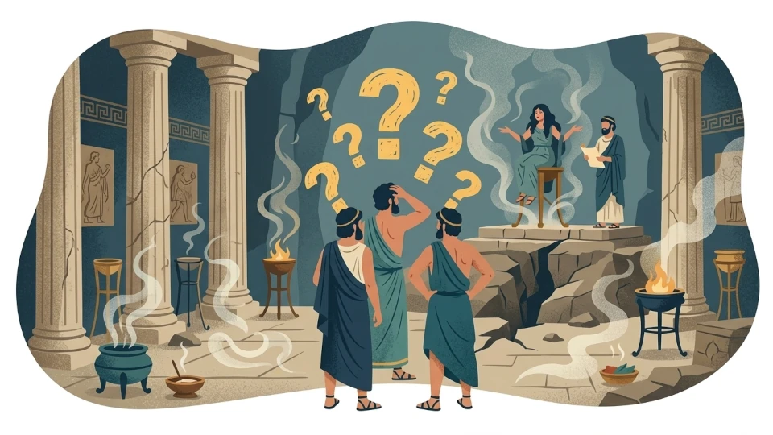
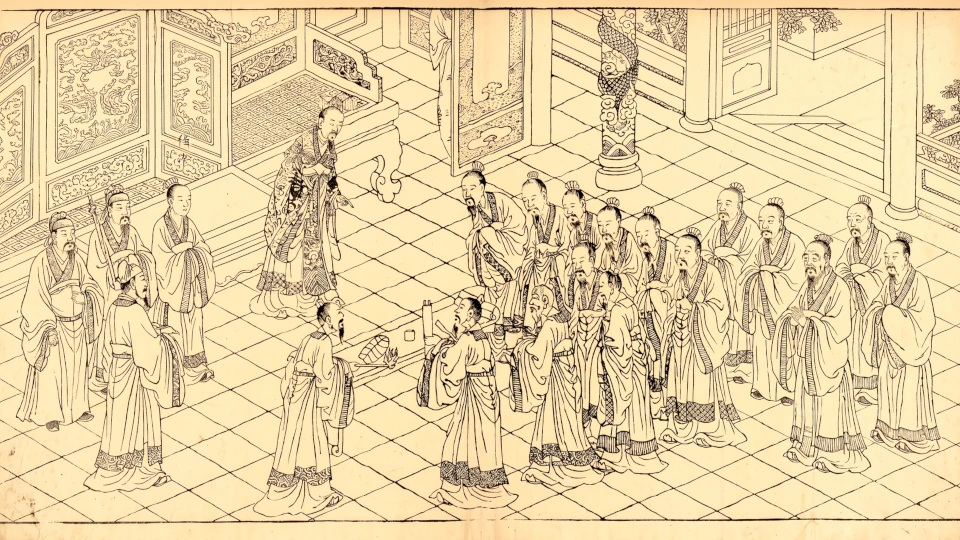

Hace poco vi una publicación en [reddit](https://www.reddit.com/r/iching/comments/1vc0ic2/what_questions_the_i_ching_do_not_answer/) con una pregunta muy importante. Tanto es así que decidí escribir un artículo al respecto con mi respuesta. Aquí está la pregunta original:

> ### ¿Qué preguntas no responde el I Ching?
>    No estoy preguntando "qué es mejor preguntar" (ejemplo: "preguntar cómo ser una mejor persona")
>    Tampoco pregunto "cómo formular las preguntas para obtener la respuesta más clara"
>    Así que no se trata del típico debate sobre preguntas de sí/no (aunque si alguien quiere añadir algo sobre los puntos anteriores, es un bonus bien recibido, pero solo como algo complementario al tema. Una buena respuesta podría ser: "el I Ching no responde preguntas sobre cuál es la comida más sabrosa que puedes conseguir hoy, y además debes pedirle consejo al I Ching y no hacerle preguntas de 'sí/no' si quieres obtener una respuesta clara").
>    
>    Algunos ejemplos:
>    
>    ¿Responde el I Ching sobre el futuro?
>    
>    ¿Da consejos sobre cómo ganar competiciones?
>    
>    ¿Da consejos sobre cuál es la mejor manera de arreglar un zapato? (Me refiero a respuestas sobre cuestiones puramente físicas y no psicológicas, ya sea de uno mismo o de otros... es decir, qué materiales usar, etc., no solo "arréglalo con modestia y perseverancia").
>    
>    También, ¿puede explicar por qué sucedieron cosas en el pasado? ("¿por qué se rompió el zapato?" "¿por qué reprobé el examen?" "¿por qué estaba enojado conmigo?" y también "¿qué le dijo Napoleón a este general?" "¿son verdaderos los eventos de la biblia?" etc.).
>    
>    ¿Puede ayudar a localizar cosas perdidas? (¿podemos localizar a todas las personas desaparecidas y secuestradas? ¿podemos localizar nuestras llaves?).
>    
>    Y por supuesto, creo que esto toca lo que el I Ching es en realidad... ¿es algún tipo de ser divino que te puede decir cualquier cosa... o es simplemente una herramienta para ayudarte a hacer una lluvia de ideas?
>    
>    (*) La razón por la que escribo esta publicación es porque empecé a sospechar que tal vez el I Ching es solo una herramienta para ayudarte a pensar un poco más claro y eso es todo; por lo tanto, cualquier pregunta sobre cómo lidiar con una situación sería simplemente ayudarte a pensar con la mente más clara y no realmente la respuesta sobre qué es lo mejor que se puede hacer.

Bueno, desglosemos esto desde la respuesta más trivial: nada te impide tomar tres monedas (o abrir mi [aplicación]()) y preguntarle cualquier cosa al I Ching; el resultado de lanzar tres monedas seis veces será un hexagrama con o sin líneas cambiantes, y ese resultado es la respuesta del I Ching a tu pregunta. El I Ching siempre responderá, pero si su respuesta te será útil o significativa de alguna manera, eso es otro asunto...

## La sustancia

Vamos directo a la pregunta que hace el usuario de reddit. No está preguntando sobre la forma (evitar preguntas de sí/no, por ejemplo, o cómo formular mejor la pregunta). Está preguntando sobre la sustancia: ¿qué tipo de preguntas puede responder el I Ching (de manera significativa)? ¿Predice el futuro? ¿Puede iluminarnos sobre eventos históricos del pasado? ¿Nos da respuestas objetivamente factuales?

Detrás de estas preguntas, percibo la suposición por parte del usuario de reddit de que el I Ching es una especie de inteligencia divina y omnisciente; de hecho, lo pregunta explícitamente. Dicha suposición se basa a su vez en la noción de que debe existir una única verdad objetiva y universal, según la cual, dada una configuración particular del Universo en un momento dado, las leyes que lo gobiernan darán como resultado otra configuración en un momento posterior, lo que equivale a decir que eventualmente podríamos predecir el futuro o, ejecutando las leyes hacia atrás, inferir el estado del Universo en un punto anterior del tiempo. Ese es esencialmente el programa positivista, el cual ha sido socavado por los descubrimientos de la mecánica cuántica del siglo XX y campos como la teoría del caos.

Y la respuesta corta es: no, el I Ching no es ningún tipo de ser divino ni una superinteligencia omnisciente. El I Ching está más alineado con la mecánica cuántica, en el sentido de que el observador es una parte esencial del sistema que se está observando, y el observador no puede desvincularse del sistema para observar la realidad de manera objetiva. Además, hay que decirlo, el I Ching está diseñado para funcionar como un espejo, propiciando las condiciones para la autoobservación.

Así que, en la práctica, esto significa que aunque es perfectamente posible hacerle al I Ching una pregunta como "¿Quién ganará las elecciones de mitad de mandato en EE. UU. en noviembre?", la respuesta y su interpretación variarán de un consultante a otro. Esto no convierte al I Ching en un buen adivino, pero lo hace un excelente psicoanalista.

Para aquellos de nosotros a quienes nos importa el mandato del Oráculo de Delfos de "conócete a ti mismo" (gnōthi seauton), el I Ching se encuentra entre las mejores herramientas que existen. Contraintuitivamente, conocerte a ti mismo y comprender las suposiciones subconscientes que impulsan tu realidad es la forma más eficaz de tomar decisiones acertadas, y eso es lo que el I Ching proporciona.

Dije antes que el I Ching no es un ser omnisciente. No es una enciclopedia que contenga todos los hechos conocidos del Universo. No es como un modelo de lenguaje (LLM) entrenado en cientos de miles de textos. Pero tampoco es una entidad que escupa símbolos y metáforas vagas y aleatorias.

Se parece más a una computadora, o a un [lenguaje analítico universal que de alguna manera codifica cómo los estados del mundo evolucionan hacia otros estados](). Así que una vez que el propio estado del consultante se mapea en sus símbolos, a través del ritual[^1] de lanzar las monedas, el símbolo resultante y sus líneas cambiantes (o la ausencia de ellas) ofrecen una perspectiva inigualable sobre la pregunta en relación con la persona que la formula.

En resumen, el límite estructural de lo que el I Ching puede responder de manera significativa se reduce a sistemas en los cuales el consultante es un componente activo, y la respuesta del I Ching es una especie de espejo de las creencias y actitudes que el consultante alberga, incluso de manera subconsciente (y particularmente en el subconsciente).

Al final de la pregunta de reddit, el usuario plantea la posibilidad de que el I Ching sea solo una herramienta para ayudarte a pensar mejor, con un tono de decepción. Sin embargo, creo que esto es lo mejor que se puede decir del I Ching en estos tiempos, cuando las personas consultan a chatbots de IA que parecen dar respuestas informadas, pero en realidad son solo loros estocásticos propensos a alucinar hechos y a la adulación. La adulación y los datos erróneos proporcionados con absoluta certeza ciertamente no convierten a nadie en un mejor pensador.

## Y la forma

Como nota final, y solo para completar este artículo sobre preguntas[^2], me gustaría agregar que antes de plantearle una pregunta al I Ching, es una buena idea formularla cuidadosamente primero. Por lo general, no se aconsejan las preguntas de sí/no porque el I Ching, aunque sus símbolos se componen de bits binarios de sí/no, no responde de manera afirmativa o negativa, sino de forma holística a través de símbolos. Las respuestas del I Ching son matizadas. Por ejemplo, piensa en cómo interpretarías el hexagrama 35 como respuesta a "¿Debería ir a ver a X?".

Las preguntas de tipo "lo uno o lo otro" deben evitarse definitivamente; si la respuesta es "sí" o algo equivalente, no sabrías a qué parte de la pregunta se refiere la respuesta del I Ching. La forma en que formulas tu pregunta también podría complicar su interpretación. Por ejemplo, si tu pregunta vuelve a ser algo como "¿Debería ir a visitar a X?", cualquier hexagrama que denote acción o cruzar el agua apuntaría a un sí; pero si formulas esa pregunta como "¿Debería quedarme en casa y no visitar a X?" (en forma pasiva o negativa), entonces, ¿cómo interpretarías un hexagrama que denote acción? ¿Significaría que uno debe quedarse en casa? ¿O significaría salir y ver a X?

Finalmente, ten en cuenta que el propósito supremo del I Ching es alinearse con el Tao y ayudar al individuo a convertirse en un hombre superior. Por lo tanto, cualquier pregunta hecha implícitamente con fines egoístas o para obtener poder sobre otro no es algo que yo aconsejaría.

## Post scriptum

El usuario de reddit preguntó si el I Ching se podía usar para localizar cosas perdidas. De hecho, existe un método basado en el I Ching, llamado adivinación de las seis líneas o Liu Yao, precisamente para eso. En mi sitio hay una aplicación que implementa este método, lista para usar, y puedes leer al respecto [aquí]().

[^1]: Dudo un poco en usar la palabra ritual aquí porque tiene connotaciones místicas o mágicas para muchas personas. Sin embargo, es un ritual porque requiere un estado mental o una actitud especial por parte del consultante para que el método funcione (véase este [artículo]()).
[^2]: Véase Hook, D. F. (1973). *The I ching and you*. Routledge & Kegan Paul.